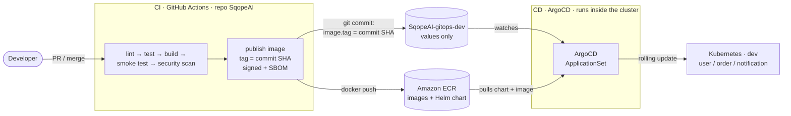
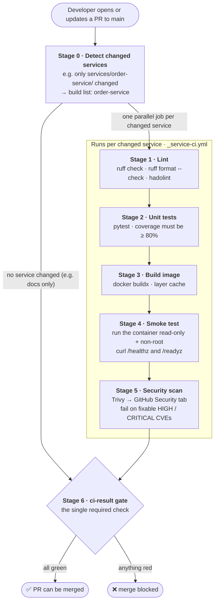
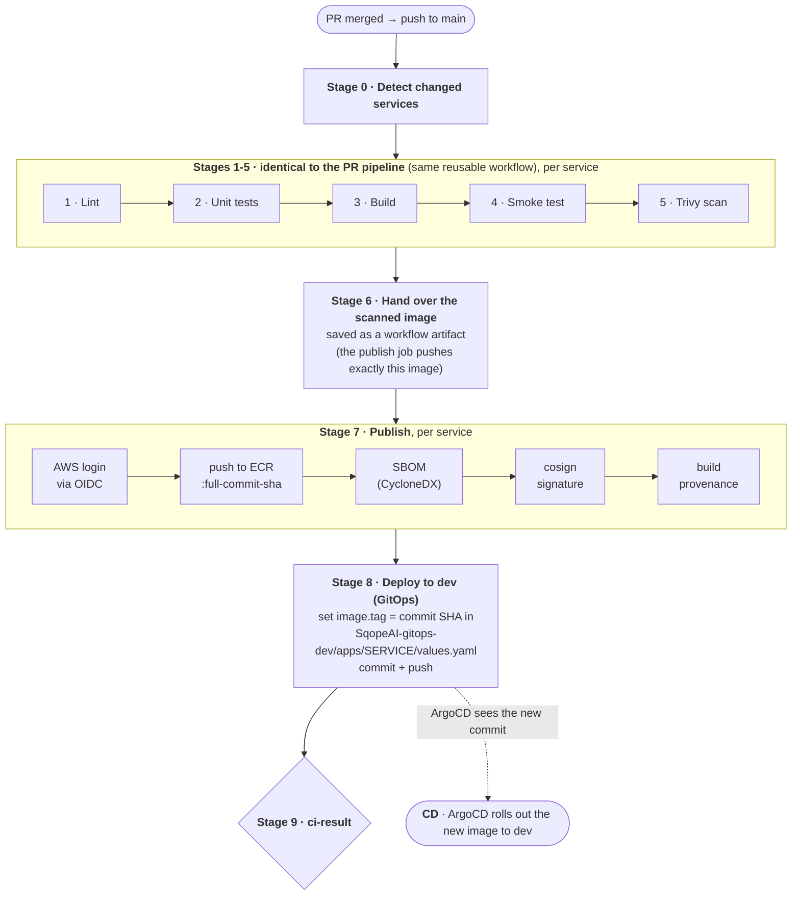
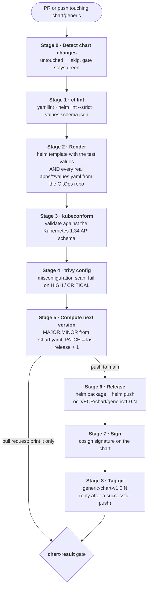
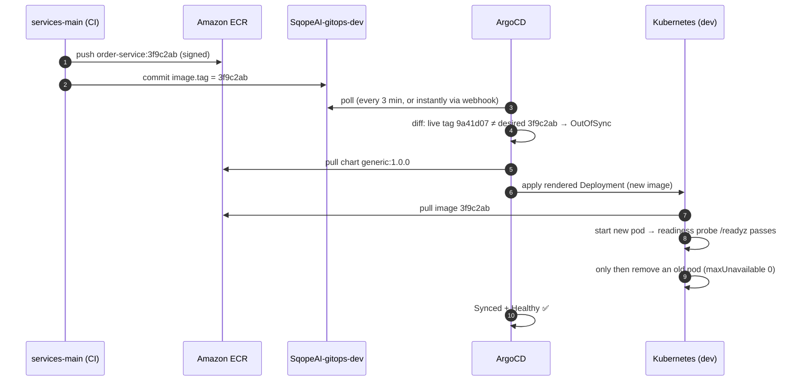
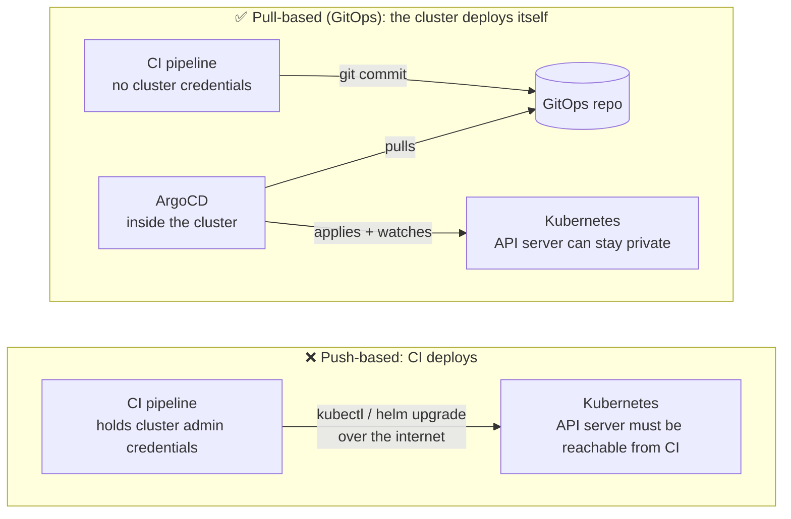

# Question 1: CI/CD

> **Assignment:** *"Design or implement a deployment pipeline that automatically builds, tests
> and deploys an application."*

**Answer: implemented, not just designed.**
- **GitHub Actions** handles **CI**: it builds, tests and scans every change, then publishes a
  signed image to Amazon ECR.
- **ArgoCD** handles **CD**: it deploys to Kubernetes the GitOps way, by watching a git repo and
  syncing the cluster to match it.
- No human step sits between *merge to main* and *the new version running in dev*, and every step
  leaves a record in git.

| | |
|---|---|
| Application code + CI pipelines | [gologolo24/SqopeAI](https://github.com/gologolo24/SqopeAI) (this repo) |
| Desired state for CD (watched by ArgoCD) | [gologolo24/SqopeAI-gitops-dev](https://github.com/gologolo24/SqopeAI-gitops-dev) |
| Live pipeline runs | [Actions tab](https://github.com/gologolo24/SqopeAI/actions) |

---

## Contents

1. [The big picture: where CI ends and CD begins](#1-the-big-picture-where-ci-ends-and-cd-begins)
2. [All pipelines at a glance](#2-all-pipelines-at-a-glance)
3. [Pipeline A: Pull request (`services-pr`)](#3-pipeline-a-pull-request-services-pr)
4. [Pipeline B: Push to main (`services-main`)](#4-pipeline-b-push-to-main-services-main)
5. [Pipeline C: Shared Helm chart (`helm-chart-cicd`)](#5-pipeline-c-shared-helm-chart-helm-chart-cicd)
6. [CD with ArgoCD](#6-cd-with-argocd)
7. [End-to-end walkthrough: one change, from laptop to cluster](#7-end-to-end-walkthrough-one-change-from-laptop-to-cluster)
8. [What runs when](#8-what-runs-when)
9. [When something fails](#9-when-something-fails)
10. [Security built into the pipeline](#10-security-built-into-the-pipeline)
11. [Why ArgoCD + GitOps is the best practice for CD](#11-why-argocd--gitops-is-the-best-practice-for-cd)
12. [Proof it works: real runs](#12-proof-it-works-real-runs)

---

## 1. The big picture: where CI ends and CD begins



**The hand-off between CI and CD is a git commit.**
- CI produces two outputs: an **image in ECR** and a **commit in the GitOps repo** that says
  *"order-service should now run image X"*.
- ArgoCD notices that commit and makes the cluster match it.

**Why GitOps: CI *pushes* to git, CD *pulls* from git.**
- **CI never touches the cluster.** GitHub holds no Kubernetes credentials, so a compromised
  pipeline can't run `kubectl` against production.
- **Git is the audit log.** `git log` of the GitOps repo is the full history of what ran in dev,
  when, and why (each commit links back to the source commit and the CI run).
- **Rollback = `git revert`.** No special tooling.
- **Self-healing.** If someone changes the cluster by hand, ArgoCD reverts it to what git says.

Section 11 explains in full why this is the industry best practice: the GitOps principles,
push-based vs pull-based deployment, and why ArgoCD.

---

## 2. All pipelines at a glance

| Pipeline | File | Trigger | What it does | Publishes |
|---|---|---|---|---|
| **A · services-pr** | [`.github/workflows/pr.yml`](.github/workflows/pr.yml) | Pull request → `main` | Validates **only the services the PR touched** | Nothing |
| **B · services-main** | [`.github/workflows/main.yml`](.github/workflows/main.yml) | Push to `main` (= merged PR) | Validates again, **publishes the image to ECR**, then **bumps the tag in GitOps** | Image + GitOps commit |
| **C · helm-chart-cicd** | [`.github/workflows/helm-chart-cicd.yml`](.github/workflows/helm-chart-cicd.yml) | PR and push → `main` (chart files only) | Validates the shared chart, and on main **releases a new version** to ECR | Helm chart (OCI) + git tag |
| Shared building block | [`.github/workflows/_service-ci.yml`](.github/workflows/_service-ci.yml) | Called by A and B | The CI stages for **one** service, defined once | |
| Shared building block | [`.github/actions/changed-services/action.yml`](.github/actions/changed-services/action.yml) | Used by A and B | Works out which services changed | |
| **CD · ArgoCD** | [`argocd/applicationset.yaml`](https://github.com/gologolo24/SqopeAI-gitops-dev/blob/main/argocd/applicationset.yaml) (GitOps repo) | A new commit in the GitOps repo | Deploys every service to dev | |

Pipelines **A** and **B** share their stages through a **reusable workflow**, so "how a service is
built and tested" is written once and can't drift between PR and main.

---

## 3. Pipeline A: Pull request (`services-pr`)

**Goal:** tell the developer, quickly and precisely, whether the PR is safe to merge, without
publishing anything.



| Stage | What happens | Fails the PR when… | Code |
|---|---|---|---|
| **0 · Detect changes** | Builds a path filter from the folders in `services/`, compares it with the PR's changed files, and outputs a list such as `["order-service"]`. If shared CI config changed (e.g. `ruff.toml`), **all** services are included. | n/a | [action.yml](.github/actions/changed-services/action.yml#L15-L56), [pr.yml#L17-L31](.github/workflows/pr.yml#L17-L31) |
| **1 · Lint** | `ruff check` (bugs, security smells, import order), `ruff format --check` (style), `hadolint` (Dockerfile best practices) | Any lint error | [_service-ci.yml#L49-L58](.github/workflows/_service-ci.yml#L49-L58), [ruff.toml](ruff.toml) |
| **2 · Unit tests** | `pytest` against the FastAPI app, with a coverage report | A test fails, or coverage drops below **80%** | [_service-ci.yml#L60-L62](.github/workflows/_service-ci.yml#L60-L62), [pyproject.toml](services/order-service/pyproject.toml), [tests](services/order-service/tests/test_main.py) |
| **3 · Build** | Multi-stage Docker build with the GitHub Actions layer cache, tagged with the commit SHA | The image doesn't build | [_service-ci.yml#L64-L77](.github/workflows/_service-ci.yml#L64-L77), [Dockerfile](services/order-service/Dockerfile) |
| **4 · Smoke test** | Starts the **built image** the way Kubernetes will run it (read-only filesystem, non-root) and polls `/healthz` and `/readyz` | The container doesn't become healthy within 30 s | [_service-ci.yml#L79-L89](.github/workflows/_service-ci.yml#L79-L89) |
| **5 · Security scan** | Trivy scans OS packages and Python libraries in the image. The full report goes to the **Security tab**, and the gate fails only on CVEs that **have a fix** | A fixable HIGH or CRITICAL vulnerability | [_service-ci.yml#L91-L119](.github/workflows/_service-ci.yml#L91-L119), [.trivyignore](.trivyignore) |
| **6 · Gate** | `ci-result` collects every result into **one** status check, which branch protection can require | Any stage above failed | [pr.yml#L48-L62](.github/workflows/pr.yml#L48-L62) |

**Why this order?** The cheapest checks run first. Lint takes seconds, tests take seconds, and a
Docker build takes a minute. Most broken PRs fail at stage 1 or 2, before any build minutes are
spent.

**Why stage 4 when we already have tests?** pytest tests the *code*. The smoke test checks the
*artifact*: a missing file in the image, a wrong `CMD`, or a library that only fails on the
read-only filesystem Kubernetes enforces.

**Properties of the PR pipeline:**
- **Only touched services run.** A PR that changes `order-service` doesn't rebuild the other two.
  That's faster feedback for a team spread across Israel, Poland and Peru.
- **Parallel.** Each changed service is its own job, and `fail-fast: false` reports every broken
  service, not just the first.
- **No credentials.** The job that runs PR code has no AWS access and publishes nothing, so a
  malicious PR can't reach the cloud.
- **Outdated runs are cancelled.** Pushing a new commit to the PR cancels the previous run.

---

## 4. Pipeline B: Push to main (`services-main`)

**Goal:** turn a merged change into a **signed, scanned image in ECR** and a **deployment to dev**,
with no human step.



| Stage | What happens | Code |
|---|---|---|
| **0 · Detect changes** | Same as the PR pipeline, but compares against the previous commit on `main` | [main.yml#L18-L29](.github/workflows/main.yml#L18-L29) |
| **1-5 · Validate** | Exactly the same stages as the PR pipeline, from the same reusable workflow. Code that reaches `main` is re-checked in its merged form. | [main.yml#L31-L45](.github/workflows/main.yml#L31-L45) |
| **6 · Hand-off** | The image that passed the scan is saved as an artifact (`docker save`, kept 1 day). The publish job **loads that same image** rather than rebuilding, so *what was scanned is byte-for-byte what is deployed*. | [_service-ci.yml#L121-L132](.github/workflows/_service-ci.yml#L121-L132), [main.yml#L77-L84](.github/workflows/main.yml#L77-L84) |
| **7 · Publish** | 1. Logs in to AWS with **GitHub OIDC**: short-lived credentials, no stored keys.<br>2. Pushes to ECR as `sqope-ai/<service>:<full commit SHA>`. ECR tags are **immutable**, so a tag can never be overwritten.<br>3. Generates an SBOM.<br>4. **Signs** the image with cosign (keyless).<br>5. Attaches build provenance (which commit and workflow built it). | [main.yml#L59-L131](.github/workflows/main.yml#L59-L131) |
| **8 · Deploy to dev** | Checks out the GitOps repo and runs `yq` to set `image.tag` to the commit SHA **for each changed service**. Makes **one commit** linking back to the source commit and CI run, and pushes it with a retry/rebase loop. Runs in the GitHub Environment `dev`, so the deploy key is only usable from `main`. | [main.yml#L133-L182](.github/workflows/main.yml#L133-L182) |
| **9 · Gate** | Aggregated result of the whole release | [main.yml#L184-L196](.github/workflows/main.yml#L184-L196) |

**Why tag with the commit SHA?** Every running pod traces back to an exact line of code. Tags like
`latest` or `v2` can move; a SHA can't. Rolling back means pointing at the previous SHA, which is
guaranteed to still exist in ECR.

**What a deploy commit in the GitOps repo looks like:**

```diff
deploy(order-service): 3f9c2ab

Source: https://github.com/gologolo24/SqopeAI/commit/3f9c2ab...
Run:    https://github.com/gologolo24/SqopeAI/actions/runs/...

 apps/order-service/values.yaml
 image:
   repository: 123456789012.dkr.ecr.eu-central-1.amazonaws.com/sqope-ai/order-service
-  tag: 9a41d07e5c...
+  tag: 3f9c2ab81d...
```

A one-line diff. That single line is the whole deployment.

> **Current state:** no AWS account is connected yet (that's the infrastructure part of the
> assignment). Until the repository variable `AWS_ROLE_ARN` is set, stages 0-6 run for real and
> stages 7-8 are **skipped with a visible notice**
> ([main.yml#L47-L57](.github/workflows/main.yml#L47-L57)), so `main` stays green. Setting the
> variable switches the full flow on, with no code change.

---

## 5. Pipeline C: Shared Helm chart (`helm-chart-cicd`)

All three services deploy with **one Helm chart**, [`chart/generic`](chart/generic). It has its own
pipeline because it's its own artifact: versioned, published to ECR as an OCI package, and
referenced by version from the GitOps repo.



| Stage | Why it matters | Code |
|---|---|---|
| **1 · ct lint** | Catches template errors, YAML problems and invalid values. The JSON schema rejects typos (`replicas:` instead of `replicaCount:`) before anything deploys. | [helm-chart-cicd.yml#L74-L75](.github/workflows/helm-chart-cicd.yml#L74-L75), [ct.yaml](ct.yaml), [values.schema.json](chart/generic/values.schema.json) |
| **2 · Render with real values** | A chart change is tested against **the actual dev configuration of every service**, not just example values, so a change that would break `order-service` in dev fails here. | [helm-chart-cicd.yml#L80-L96](.github/workflows/helm-chart-cicd.yml#L80-L96) |
| **3 · kubeconform** | Validates the rendered YAML against the real Kubernetes API, catching mistakes that `helm lint` can't. | [helm-chart-cicd.yml#L98-L115](.github/workflows/helm-chart-cicd.yml#L98-L115) |
| **4 · trivy config** | Flags insecure manifests (privileged containers, missing limits, root user…). | [helm-chart-cicd.yml#L117-L123](.github/workflows/helm-chart-cicd.yml#L117-L123) |
| **5 · Version** | Nobody has to remember to bump the version. CI **never commits back to `main`**: the released version lives in git tags and ECR. | [chart-next-version.sh](.github/scripts/chart-next-version.sh), [Chart.yaml](chart/generic/Chart.yaml) |
| **6-8 · Release** | Pushed to ECR as an immutable OCI artifact, signed, and tagged in git only after the push succeeded. A `concurrency` lock stops two merges from releasing the same version. | [helm-chart-cicd.yml#L143-L206](.github/workflows/helm-chart-cicd.yml#L143-L206) |

**Versioning example:**

| `Chart.yaml` version | Existing git tags | Next release |
|---|---|---|
| `1.0.0` | none | `1.0.0` |
| `1.0.0` | `generic-chart-v1.0.0` … `v1.0.9` | `1.0.10` |
| `1.1.0` (a human bumped MINOR for a new feature) | `…v1.0.10` | `1.1.0` |

**Rolling out a new chart version is deliberate.** Releasing `generic:1.0.N` doesn't change any
environment. Dev picks it up only after a PR bumps `targetRevision` in the GitOps repo, so a chart
change can never silently reach every environment at once.

---

## 6. CD with ArgoCD

ArgoCD runs **inside the Kubernetes cluster** and continuously compares the cluster with the GitOps
repo. When they differ, it syncs the cluster to match git.

### What ArgoCD watches

```
SqopeAI-gitops-dev/
├── apps/
│   ├── user-service/values.yaml          ← image.tag bumped by CI on every merge
│   ├── order-service/values.yaml
│   └── notification-service/values.yaml
├── argocd/
│   ├── project.yaml                      ← AppProject: allowed sources, namespaces, resource kinds
│   └── applicationset.yaml               ← generates one ArgoCD Application per apps/* folder
└── bootstrap/root-app.yaml               ← app-of-apps, applied once per cluster
```

| Piece | What it does | Code |
|---|---|---|
| **ApplicationSet** | A *git directory generator* creates one ArgoCD Application per folder in `apps/`. **Adding a service = adding a folder.** | [applicationset.yaml#L13-L19](https://github.com/gologolo24/SqopeAI-gitops-dev/blob/main/argocd/applicationset.yaml#L13-L19) |
| **Multi-source app** | Each Application combines **(1) the `generic` chart from ECR** at a pinned version with **(2) that service's `values.yaml` from git**. | [applicationset.yaml#L30-L41](https://github.com/gologolo24/SqopeAI-gitops-dev/blob/main/argocd/applicationset.yaml#L30-L41) |
| **Auto-sync** | `prune` deletes what was removed from git, `selfHeal` reverts manual `kubectl` changes, and `retry` with backoff handles transient errors. | [applicationset.yaml#L45-L58](https://github.com/gologolo24/SqopeAI-gitops-dev/blob/main/argocd/applicationset.yaml#L45-L58) |
| **AppProject** | Least privilege: ArgoCD may deploy only from this repo and the ECR chart, only into `*-service` namespaces, and only the resource kinds the chart produces. | [project.yaml](https://github.com/gologolo24/SqopeAI-gitops-dev/blob/main/argocd/project.yaml) |
| **App-of-apps** | ArgoCD manages its own configuration from git too. Only this one file is applied by hand, once. | [root-app.yaml](https://github.com/gologolo24/SqopeAI-gitops-dev/blob/main/bootstrap/root-app.yaml) |

### How a deploy reaches the pods (zero downtime)



The chart makes the rollout safe:

| Setting | Effect | Code |
|---|---|---|
| `maxUnavailable: 0`, `maxSurge: 25%` | New pods start **before** old ones stop. Capacity never drops during a deploy. | [values.yaml#L80-L83](chart/generic/values.yaml#L80-L83), [deployment.yaml#L12-L16](chart/generic/templates/deployment.yaml#L12-L16) |
| `startupProbe` / `readinessProbe` | A pod gets traffic only when `/readyz` answers. A **broken version never receives traffic**, and the rollout stalls instead of taking the service down. | [deployment.yaml#L65-L82](chart/generic/templates/deployment.yaml#L65-L82) |
| `preStop` sleep | Gives the load balancer time to stop sending traffic before the old pod exits, so no requests are dropped. | [deployment.yaml#L83-L86](chart/generic/templates/deployment.yaml#L83-L86) |
| PodDisruptionBudget + topology spread | Node drains and AZ failures can't take down every replica. | [pdb.yaml](chart/generic/templates/pdb.yaml), [deployment.yaml#L98-L112](chart/generic/templates/deployment.yaml#L98-L112) |

---

## 7. End-to-end walkthrough: one change, from laptop to cluster

*A developer in Poland fixes a bug in `order-service`.*

| # | What happens | Where | Who |
|---|---|---|---|
| 1 | Opens a PR that changes `services/order-service/app/main.py` | GitHub | Developer |
| 2 | `services-pr` detects **only order-service** changed and runs lint, tests, build, smoke test and scan for it. user and notification are skipped. | Pipeline A | CI |
| 3 | `ci-result` is green; a teammate in Israel reviews and merges | GitHub | Humans |
| 4 | `services-main` re-runs stages 1-5 on `main`, then pushes `order-service:<sha>` to ECR, signed and with an SBOM | Pipeline B | CI |
| 5 | CI commits `image.tag: <sha>` to `apps/order-service/values.yaml` in the GitOps repo | Pipeline B, stage 8 | CI |
| 6 | ArgoCD sees the commit, renders the `generic` chart with the new values, and starts a rolling update | Cluster | CD |
| 7 | New pods pass `/readyz`, old pods drain, and ArgoCD reports **Synced + Healthy** | Cluster | CD |
| 8 | *(If something looks wrong)* `git revert` the deploy commit. ArgoCD rolls back to the previous SHA. | GitOps repo | Anyone on call |

From merge to running in dev, nobody touches a server, runs `kubectl`, or copies a credential.

---

## 8. What runs when

| Change | Pipeline A / B (services) | Pipeline C (chart) |
|---|---|---|
| PR touches `services/order-service/**` | **order-service only** | skipped (gate green) |
| PR touches `chart/generic/**` | no service builds (gate green) | validate + print the next version |
| PR touches `ruff.toml` or a service workflow | **all 3 services** (shared config) | skipped |
| PR touches only docs | nothing runs (both gates green) | skipped |
| Merge touching `order-service` | validate → publish `order-service:<sha>` → GitOps bump → ArgoCD deploys | skipped |
| Merge touching the chart | nothing | validate → release `generic:1.0.N` → sign → git tag |

---

## 9. When something fails

| Failure | What happens | Impact on dev |
|---|---|---|
| Lint, test, smoke test or scan fails on a PR | `ci-result` is red and the merge is blocked | None |
| Any stage fails on `main` | Nothing is pushed to ECR and the GitOps repo isn't touched | **None**: dev keeps running the previous version |
| Two merges land at the same time | The GitOps update is serialized (`concurrency: gitops-dev`) and the push rebases and retries | None |
| The new image starts but is unhealthy | The readiness probe fails, the rollout stalls, and old pods keep serving | **None**: no downtime |
| A bad version is live | `git revert` the deploy commit, and ArgoCD syncs back to the previous SHA within minutes | Short, controlled |

Full disaster recovery is covered in question 6.

---

## 10. Security built into the pipeline

| Practice | Where |
|---|---|
| **No stored cloud keys.** GitHub OIDC gives short-lived AWS credentials, and only the `main` branch can assume the role. | [main.yml#L86-L91](.github/workflows/main.yml#L86-L91) |
| **Least privilege per job.** The job that runs PR code has no `id-token`. Only the publish job can reach AWS. | [_service-ci.yml#L27-L29](.github/workflows/_service-ci.yml#L27-L29), [main.yml#L69-L72](.github/workflows/main.yml#L69-L72) |
| **Deploy key scoped to the `dev` environment**, which only `main` can use | [main.yml#L138-L140](.github/workflows/main.yml#L138-L140) |
| **Scan before push.** Vulnerable images never reach the registry. | [_service-ci.yml#L109-L119](.github/workflows/_service-ci.yml#L109-L119) |
| **Signed images + SBOM + provenance**, verifiable later at admission | [main.yml#L110-L131](.github/workflows/main.yml#L110-L131) |
| **Immutable SHA tags** in ECR | [README → infra expectations](README.md#enabling-the-full-pipeline-aws) |
| **Actions pinned to commit SHAs**, kept fresh by Dependabot | every `uses:` line, [dependabot.yml](.github/dependabot.yml) |

Secrets management is covered in question 4.

---

## 11. Why ArgoCD + GitOps is the best practice for CD

### GitOps in one sentence

> **Git is the single source of truth for what runs in an environment, and an agent inside the
> cluster continuously makes reality match git.**

Deploying stops being *"run a script against the cluster"* and becomes *"change a file in git"*.
Everything teams already do with code (review, history, revert, blame, branch protection) now
applies to deployments too.

### The four GitOps principles, and how this project applies each one

GitOps is defined by four principles, published by
[OpenGitOps](https://opengitops.dev/), a CNCF working group. This project follows all four:

| # | Principle | What it means | How we apply it |
|---|---|---|---|
| 1 | **Declarative** | Describe the *desired state*, not the steps to reach it | The Helm chart and `values.yaml` describe what should run (image, replicas, probes, resources). No pipeline runs imperative `kubectl` or `helm upgrade` commands. |
| 2 | **Versioned and immutable** | The desired state is stored in a way that keeps full history and can't be silently changed | Every change to dev is a commit in [SqopeAI-gitops-dev](https://github.com/gologolo24/SqopeAI-gitops-dev/commits/main). The artifacts it points to are immutable too: images are tagged with the commit SHA in immutable ECR repos, and chart versions are immutable in ECR. |
| 3 | **Pulled automatically** | Agents in the environment *pull* the desired state; nothing *pushes* into the cluster | ArgoCD runs inside the cluster and pulls from git and ECR. CI only writes to git and has **no cluster credentials at all**. |
| 4 | **Continuously reconciled** | Agents keep comparing actual state with desired state and correct any drift | ArgoCD auto-sync with `selfHeal: true` and `prune: true` ([applicationset.yaml#L45-L58](https://github.com/gologolo24/SqopeAI-gitops-dev/blob/main/argocd/applicationset.yaml#L45-L58)). A manual `kubectl edit` is detected and reverted. |

### Push-based vs pull-based CD

The traditional alternative is a **push-based** pipeline, where CI itself runs `kubectl apply` or
`helm upgrade` against the cluster at the end:



| | Push-based (CI runs `kubectl` / `helm`) | **Pull-based GitOps (ArgoCD)**: our choice |
|---|---|---|
| **Cluster credentials** | Stored in CI secrets. A leaked token or a compromised pipeline means a compromised cluster. | Never leave the cluster. CI can only write to one git repo. |
| **Network exposure** | The Kubernetes API must be reachable from CI runners | The API server can stay private. ArgoCD only makes outbound connections to git and ECR. |
| **Drift** | Manual changes go unnoticed until the next deploy overwrites them (or doesn't) | Detected within minutes and reverted automatically (`selfHeal`) |
| **Audit trail** | Scattered across CI logs, which expire | `git log`: who changed what, when, why, and who approved it, kept forever |
| **Rollback** | Find and re-run an old pipeline, or run `helm rollback` by hand | `git revert`, the same skill every developer already has |
| **Review** | The deploy happens as a side effect of a pipeline | Changes to an environment are PRs, with branch protection and required approvals for staging and prod |
| **Disaster recovery** | Rebuilding a cluster means re-running every pipeline in the right order | New cluster + ArgoCD + one root app: the **whole environment is restored from git** |
| **Multiple environments and clusters** | A pipeline step and credentials per cluster | Each cluster pulls its own repo or path. Adding a cluster adds no CI secrets. |
| **Visibility** | Pipeline logs | ArgoCD UI: live resource tree, health, a diff against git, sync history |

### Why ArgoCD specifically

| Reason | Why it matters for Sqope AI |
|---|---|
| **A CNCF *graduated* project**, the same maturity level as Kubernetes and Prometheus | Proven at scale with a large community, and the de facto standard for GitOps on Kubernetes. No vendor lock-in. |
| **A web UI with live state, health and diffs** | A team spread across Israel, Poland and Peru can all see what's running in dev, whether it's healthy and what changed, **without anyone needing `kubectl` access** |
| **ApplicationSet** | One template generates an Application per service. We use it: [a new service = a new folder](https://github.com/gologolo24/SqopeAI-gitops-dev/blob/main/argocd/applicationset.yaml#L13-L19). |
| **Multi-source Applications** | The chart comes from ECR (OCI) at a pinned version, and the values come from git. We use it: [applicationset.yaml#L30-L41](https://github.com/gologolo24/SqopeAI-gitops-dev/blob/main/argocd/applicationset.yaml#L30-L41). |
| **Health assessment** | ArgoCD knows whether a Deployment actually *rolled out and became healthy*, not just whether the YAML was applied |
| **Sync policies**: auto-sync, prune, self-heal, retry, sync waves and hooks | Fully automatic for dev today, and ordered steps (such as running DB migrations before the app) when they're needed |
| **AppProjects + RBAC + SSO** | Least privilege per team and environment. Our [AppProject](https://github.com/gologolo24/SqopeAI-gitops-dev/blob/main/argocd/project.yaml) limits sources, namespaces and resource kinds. With SSO, most engineers get read-only access and on-call engineers get sync rights. |
| **Notifications** (Slack, e-mail, webhooks) | Alerts on failed syncs or degraded health. This feeds into monitoring and alerting (question 5). |
| **History and rollback** | Every sync is recorded and linked to the git commit that caused it |

**Alternatives considered:**

| Option | Verdict |
|---|---|
| **Flux CD** | Also CNCF graduated and also a solid GitOps choice. It's CLI- and CRD-first with no built-in UI, so it's less visible for a distributed team that isn't on kubectl. |
| **CI push** (`helm upgrade` from GitHub Actions) | Simplest to start with, but it fails the security, drift and audit points in the table above |
| **Spinnaker** | Powerful but heavy to run. Too much overhead for a team of this size. |

**In short:** GitHub Actions answers *"is this change good, and what is the artifact?"* (CI).
ArgoCD answers *"is the cluster running exactly what git says?"* (CD). Keeping those two jobs
separate is what makes the system secure, auditable and recoverable.

---

## 12. Proof it works: real runs

The pipelines aren't theoretical. They have already run on this repo and done their job:

1. **The first push to `main`** ([run](https://github.com/gologolo24/SqopeAI/actions/runs/45855777421))
   built, tested and smoke-tested all three services. Then the **Trivy gate blocked the release**:
   - `libzstd1` (HIGH) in the Debian base image
   - five HIGH CVEs in libraries that pip bundles inside itself

   Nothing was published.
2. **The fix went through a PR**, [PR #1](https://github.com/gologolo24/SqopeAI/pull/1). It applies
   OS security updates at build time and removes pip from the runtime image, so less ships and
   less can be attacked. `services-pr` rebuilt all three services, because all three Dockerfiles
   changed, and **every check passed**, including the Trivy gate.
3. **The chart pipeline** validated `chart/generic` against the real dev values of all three
   services, with kubeconform and the Trivy config scan, and passed on its first run.

That is the purpose of a pipeline: a real vulnerability was caught automatically and fixed through
the normal review flow, and it never reached the registry.
