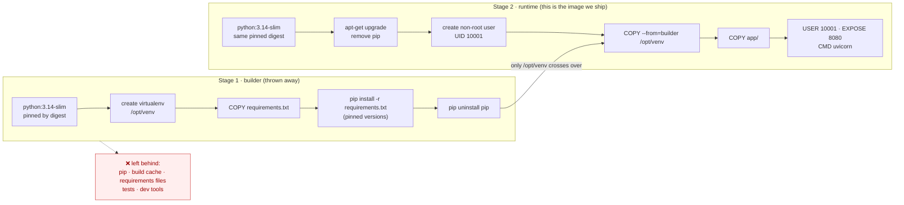
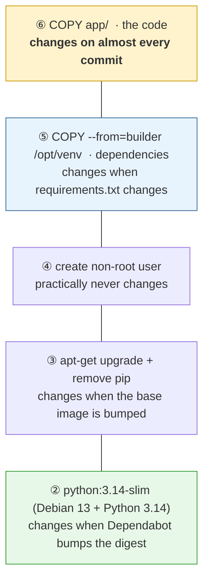
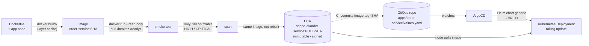
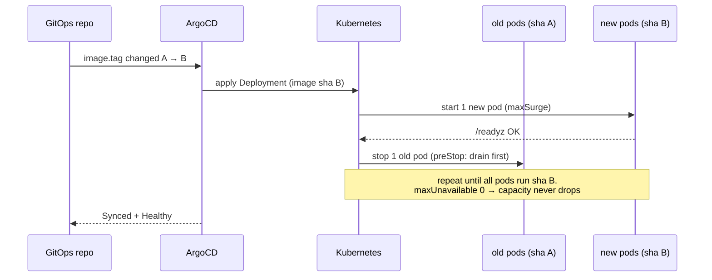

# Question 3: Docker

> **Assignment:** *"Containerize a sample application and explain how you would manage its
> deployment."*

**Answer:**
- **Containerized:** 3 Python (FastAPI) microservices, each with its own **multi-stage, layered,
  hardened Dockerfile**.
- **Built and checked:** CI builds the image once, smoke-tests it, scans it, and pushes it to ECR
  tagged with the **git commit SHA**.
- **Deployed:** **ArgoCD** runs it on Kubernetes through GitOps, using one shared Helm chart.

| | |
|---|---|
| Dockerfiles | [user-service](services/user-service/Dockerfile) · [order-service](services/order-service/Dockerfile) · [notification-service](services/notification-service/Dockerfile) (same pattern, only the name differs) |
| How CI builds it | [README-CICD.md](README-CICD.md) (question 1) |
| How it's deployed | [SqopeAI-gitops-dev](https://github.com/gologolo24/SqopeAI-gitops-dev) + [chart/generic](chart/generic) |

---

## Contents
1. [The application](#1-the-application)
2. [The Dockerfile: two stages](#2-the-dockerfile-two-stages)
3. [Layers and the build cache](#3-layers-and-the-build-cache)
4. [Hardening: what's in the image and what isn't](#4-hardening-whats-in-the-image-and-what-isnt)
5. [From Dockerfile to running pod](#5-from-dockerfile-to-running-pod)
6. [How the deployment is managed (ArgoCD)](#6-how-the-deployment-is-managed-argocd)
7. [The image and Kubernetes fit together](#7-the-image-and-kubernetes-fit-together)
8. [Updates, rollbacks and keeping images patched](#8-updates-rollbacks-and-keeping-images-patched)
9. [Try it locally](#9-try-it-locally)
10. [Design decisions](#10-design-decisions)

---

## 1. The application

Each service is a small FastAPI app ([order-service](services/order-service/app/main.py)) with what
a container platform needs:

| Endpoint | Used by |
|---|---|
| `/healthz` | Kubernetes **liveness** and **startup** probes (is the process alive?) |
| `/readyz` | Kubernetes **readiness** probe (can it take traffic?) and the CI smoke test |
| `/metrics` | Prometheus (request rate, errors, latency) |
| `/orders`, `/users`, `/notifications` | The business API |

The apps also follow the container conventions that make the rest of the setup work:
- **Logs go to stdout as JSON**, so the cluster log agent collects them and nothing is written to
  disk.
- **Config comes from environment variables** (`LOG_LEVEL`, `ENVIRONMENT`), so the same image runs
  in every environment.

---

## 2. The Dockerfile: two stages

The Dockerfile has two stages. The **builder** installs the dependencies, and the **runtime**
stage copies in **only the result**. Everything needed to build but not to run stays behind.



Line by line ([order-service/Dockerfile](services/order-service/Dockerfile)):

| Lines | What | Why |
|---|---|---|
| [L1](services/order-service/Dockerfile#L1) | `# syntax=docker/dockerfile:1` | Uses the current BuildKit Dockerfile syntax |
| [L4](services/order-service/Dockerfile#L4) | `FROM python:3.14-slim@sha256:…  AS builder` | **Slim** Debian base (small, glibc, so Python wheels just work). It's **pinned by digest**, so the same Dockerfile always builds on the same base. Dependabot bumps the digest weekly. |
| [L5-L9](services/order-service/Dockerfile#L5-L9) | No pip cache, create a venv | A venv is a single self-contained folder (`/opt/venv`) that's easy to copy into the next stage |
| [L10](services/order-service/Dockerfile#L10) | `COPY requirements.txt .` **before** any code | Layer-cache trick (see section 3): dependencies are reinstalled only when `requirements.txt` changes |
| [L12-L13](services/order-service/Dockerfile#L12-L13) | `pip install` pinned deps, then `pip uninstall pip` | Exact versions mean reproducible builds. pip isn't needed at runtime, so it doesn't ship. |
| [L16](services/order-service/Dockerfile#L16) | Second `FROM`, same digest | A fresh, clean filesystem. Nothing from the builder comes along unless it's explicitly copied. |
| [L17-L20](services/order-service/Dockerfile#L17-L20) | `ARG GIT_SHA` + OCI `LABEL`s | Every image records **which commit and repo built it**: `docker inspect` gives you the source |
| [L24-L28](services/order-service/Dockerfile#L24-L28) | `apt-get upgrade`, remove pip | Picks up Debian security fixes newer than the base image, and removes the package manager (see section 4) |
| [L29-L32](services/order-service/Dockerfile#L29-L32) | `ENV` | `PYTHONUNBUFFERED` sends logs out immediately. `PYTHONDONTWRITEBYTECODE` writes no `.pyc` files, which the read-only filesystem needs. `APP_VERSION` is the commit SHA, shown by `/readyz`. |
| [L33-L34](services/order-service/Dockerfile#L33-L34) | Create user `app` (UID 10001, no shell, no home) | The app **never runs as root** |
| [L36](services/order-service/Dockerfile#L36) | `COPY --from=builder /opt/venv` | Brings in **only** the installed dependencies |
| [L37](services/order-service/Dockerfile#L37) | `COPY app ./app` | The code: the **last** layer, because it changes most often |
| [L38-L40](services/order-service/Dockerfile#L38-L40) | `USER 10001:10001`, `EXPOSE 8080`, exec-form `CMD` | Non-root. A port above 1024 needs no privileges. Exec form makes uvicorn PID 1, so it receives `SIGTERM` and shuts down gracefully. |

[`.dockerignore`](services/order-service/.dockerignore) keeps tests, caches, dev requirements and
local virtualenvs out of the build context. Builds are faster and nothing unexpected ends up in the
image.

---

## 3. Layers and the build cache

An image is a **stack of read-only layers**. Each filesystem instruction (`FROM`, `RUN`, `COPY`)
adds one. When something changes, Docker rebuilds **that layer and every layer above it**, and
reuses the cache for everything below.

**The rule: order layers from what changes least to what changes most.**



| What changed | Layers rebuilt | Result |
|---|---|---|
| A line of Python code | Only ⑥ | A **seconds-long** build. Only a small layer is pushed, and nodes pull only that layer. |
| `requirements.txt` | Builder `pip install` + ⑤ + ⑥ | Dependencies reinstalled; base layers reused |
| Base image digest (Dependabot PR) | Everything | Fresh OS patches. This happens weekly and on purpose. |

**In CI** the layer cache is kept between runs in the GitHub Actions cache, with a **separate
scope per service** (`cache-from/cache-to: type=gha,scope=<service>`,
[_service-ci.yml#L67-L77](.github/workflows/_service-ci.yml#L67-L77)). A typical code-only
change rebuilds just the last layer.

**Why two stages help the cache too:** the builder stage can change (new build tools, compilers)
without touching the runtime layers. The runtime image only changes when its own inputs change.

---

## 4. Hardening: what's in the image and what isn't

| ✅ In the image | ❌ Not in the image |
|---|---|
| Python 3.14 runtime (slim Debian, patched at build time) | **pip** and its bundled libraries (removed: a recurring CVE source) |
| `/opt/venv` with the pinned runtime dependencies | Build cache, `requirements*.txt`, compilers |
| `app/` code | Tests, pytest, ruff, coverage (dev-only) |
| A non-root user, UID 10001 | A shell for the app user (`/usr/sbin/nologin`) |
| Labels: source repo and commit SHA | Secrets: **none**. Config and secrets are injected at runtime by Kubernetes. |

This is **verified, not just claimed**. On the first push, the Trivy scan in CI found HIGH CVEs in
the base OS (`libzstd1`) and in pip's bundled libraries. The fix (`apt-get upgrade` + removing pip)
went through [PR #1](https://github.com/gologolo24/SqopeAI/pull/1), and the scan has passed since.

---

## 5. From Dockerfile to running pod



| Step | Where | What it guarantees |
|---|---|---|
| **Build** | [_service-ci.yml#L67-L77](.github/workflows/_service-ci.yml#L67-L77) | Built by CI, never on a laptop. The commit SHA is baked into the labels. |
| **Smoke test** | [_service-ci.yml#L79-L89](.github/workflows/_service-ci.yml#L79-L89) | The **image itself** starts and answers health checks **under Kubernetes conditions**: read-only filesystem, writable `/tmp` only, non-root |
| **Scan** | [_service-ci.yml#L109-L119](.github/workflows/_service-ci.yml#L109-L119) | No known fixable HIGH or CRITICAL vulnerabilities |
| **Hand-off** | [_service-ci.yml#L121-L132](.github/workflows/_service-ci.yml#L121-L132) | The image that was tested and scanned is the one that gets pushed (**build once**) |
| **Push** | [main.yml#L97-L108](.github/workflows/main.yml#L97-L108) | Tagged with the **full commit SHA** in an **immutable** ECR repo, then signed with cosign, with an SBOM and provenance attached |
| **Deploy** | [main.yml#L133-L182](.github/workflows/main.yml#L133-L182) → ArgoCD | A one-line change in git, synced by ArgoCD (next section) |

---

## 6. How the deployment is managed (ArgoCD)

Deploying is **not** `docker run` on a server and **not** `kubectl apply` from CI. It's
**GitOps**:

1. CI writes the new image tag into git:
   [`apps/order-service/values.yaml`](https://github.com/gologolo24/SqopeAI-gitops-dev/blob/main/apps/order-service/values.yaml)
   → `image.tag: <commit-sha>`
2. **ArgoCD**, running inside the cluster, sees the commit. It renders the shared Helm chart
   [`chart/generic`](chart/generic) with that values file and applies the result.
3. Kubernetes performs a **rolling update**: it starts a new pod, waits for `/readyz`, and only
   then removes an old pod.



**Why manage it this way?**
- **One chart for every service:** every container gets the same probes, security context,
  resources and rollout strategy. A new service only needs a values file.
- **Git is the record of what runs:** who deployed which SHA, when, and why.
- **Drift is corrected automatically** (`selfHeal`), and **rollback is `git revert`**.
- **The cluster pulls; CI never holds cluster credentials.**
- **Scaling** is declared in values: fixed `replicaCount`, or an HPA, as for
  [order-service](https://github.com/gologolo24/SqopeAI-gitops-dev/blob/main/apps/order-service/values.yaml).

The full GitOps explanation is in [README-CICD.md § 6 and § 11](README-CICD.md#6-cd-with-argocd).

---

## 7. The image and Kubernetes fit together

The Dockerfile and the Helm chart were designed as a pair. Every runtime guarantee of the image has
a matching setting in the chart:

| In the Dockerfile | In the chart ([values.yaml](chart/generic/values.yaml), [deployment.yaml](chart/generic/templates/deployment.yaml)) |
|---|---|
| `USER 10001:10001` | `runAsNonRoot: true`, `runAsUser: 10001` ([values.yaml#L93-L99](chart/generic/values.yaml#L93-L99)). Kubernetes **refuses to start** the pod if the image tries to run as root. |
| `PYTHONDONTWRITEBYTECODE`, nothing written to the image | `readOnlyRootFilesystem: true` plus an `emptyDir` mounted at `/tmp` ([deployment.yaml#L89-L97](chart/generic/templates/deployment.yaml#L89-L97)) |
| No extra Linux privileges needed | `capabilities: drop: [ALL]`, `allowPrivilegeEscalation: false`, seccomp `RuntimeDefault` |
| `EXPOSE 8080` | `containerPort: 8080`, Service port 80 → 8080 |
| `/healthz`, `/readyz` in the app | `startupProbe`, `livenessProbe`, `readinessProbe` ([deployment.yaml#L65-L82](chart/generic/templates/deployment.yaml#L65-L82)) |
| Exec-form `CMD` (uvicorn is PID 1 and gets `SIGTERM`) | `preStop` sleep + `terminationGracePeriodSeconds` for a graceful drain |
| Logs to stdout | Nothing to configure: the node's log agent collects them |
| Config from env vars | `env:` in each service's values file. Secrets through `envFromSecrets` (from AWS Secrets Manager via External Secrets, never baked into the image) |
| Small image, fast start | Fast scale-out by the HPA and quick rollouts |

**The CI smoke test runs the container the same way** (`--read-only --tmpfs /tmp`, non-root), so an
image that would break under these rules **fails in CI, not in the cluster**.

---

## 8. Updates, rollbacks and keeping images patched

| Situation | What happens |
|---|---|
| **New code** | Merge → new image `:<new-sha>` → GitOps commit → ArgoCD rolling update |
| **New dependency version** | A Dependabot PR to `requirements.txt` goes through the same CI (tests, smoke test, scan), then the same flow |
| **New OS patches** | A Dependabot PR bumps the base image digest. The rebuild also runs `apt-get upgrade`. |
| **A new CVE in a running image** | ECR scan-on-push and the Trivy gate on the next build catch it, and a rebuild picks up the fix |
| **The new version is broken** | The readiness probe fails → the rollout **stalls**, and old pods keep serving traffic |
| **Roll back** | `git revert` the deploy commit in the GitOps repo → ArgoCD deploys the previous SHA. That image still exists because ECR tags are immutable. |

---

## 9. Try it locally

```bash
cd services/order-service

# build (pass the commit so the image is labelled like in CI)
docker build -t order-service:local --build-arg GIT_SHA="$(git rev-parse HEAD)" .

# see the layers and their sizes
docker history order-service:local

# see the labels CI bakes in
docker inspect order-service:local --format '{{json .Config.Labels}}'

# run it exactly like Kubernetes does: read-only, only /tmp writable, non-root
docker run --rm -p 8080:8080 --read-only --tmpfs /tmp order-service:local

# in another terminal
curl localhost:8080/readyz
curl -X POST localhost:8080/orders -H 'content-type: application/json' \
  -d '{"user_id":"u-1","items":[{"sku":"plan-pro","quantity":2,"unit_price":"49.90"}]}'

# prove it does not run as root
docker run --rm --entrypoint id order-service:local   # uid=10001(app) gid=10001(app)
```

---

## 10. Design decisions

| Decision | Why | Alternatives considered |
|---|---|---|
| **Multi-stage build** | The shipped image holds only what's needed to run, which means smaller size, faster pulls and fewer CVEs | Single stage (ships pip and build leftovers) |
| **`python:3.14-slim` base** | Small, Debian/glibc (Python wheels install without compiling), well-maintained official image | **Alpine**: musl breaks many wheels and means slow source builds. **Distroless**: even smaller but harder to debug; a good next step. |
| **Base pinned by digest + Dependabot** | Reproducible builds, with updates still arriving weekly | `:3.14-slim` tag only (moves silently, so it isn't reproducible) |
| **Dependencies copied before code** | Code changes rebuild only the last layer | Copying everything first (every commit reinstalls all dependencies) |
| **Non-root, read-only, no package manager** | If the app is compromised, the attacker can't install tools, modify files or escalate | Default root container |
| **Image tag = commit SHA, immutable** | Every running pod traces back to an exact commit, and rollback targets always exist | `latest` (unknown content, can't roll back reliably) |
| **Build once, promote the same image** | What was tested and scanned is exactly what runs, in dev and later in staging and prod | Rebuilding per environment (risk of a different artifact) |
| **One shared Helm chart, deployed by ArgoCD** | Same production defaults for every container. Deploys are git commits. | A chart per service; `kubectl` / `helm` from CI (see README-CICD § 11) |
