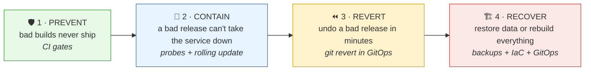
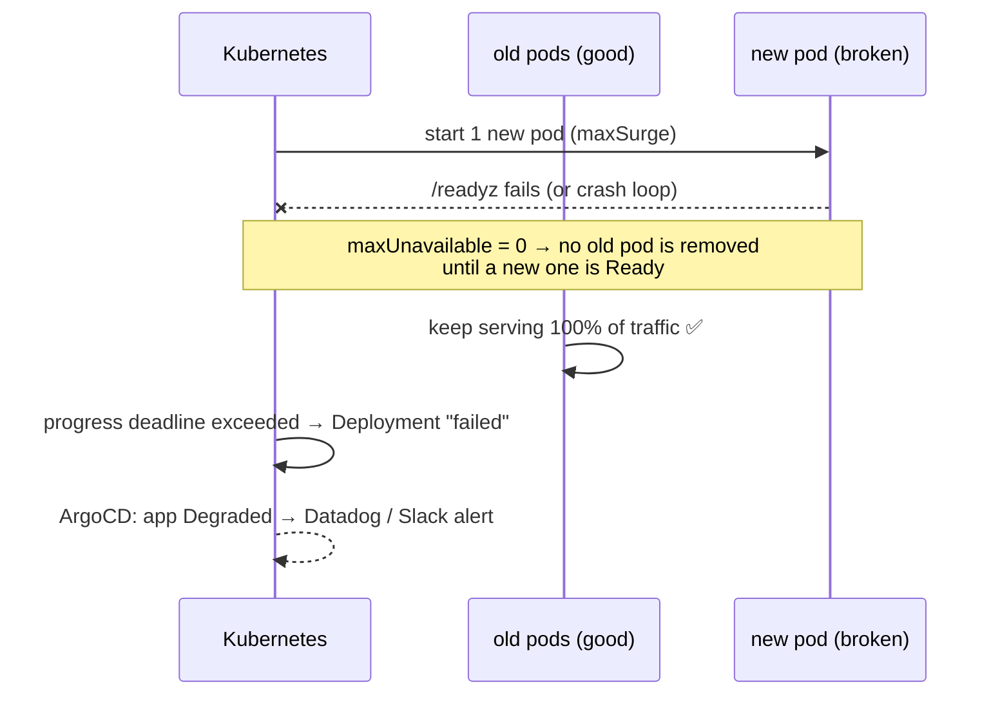
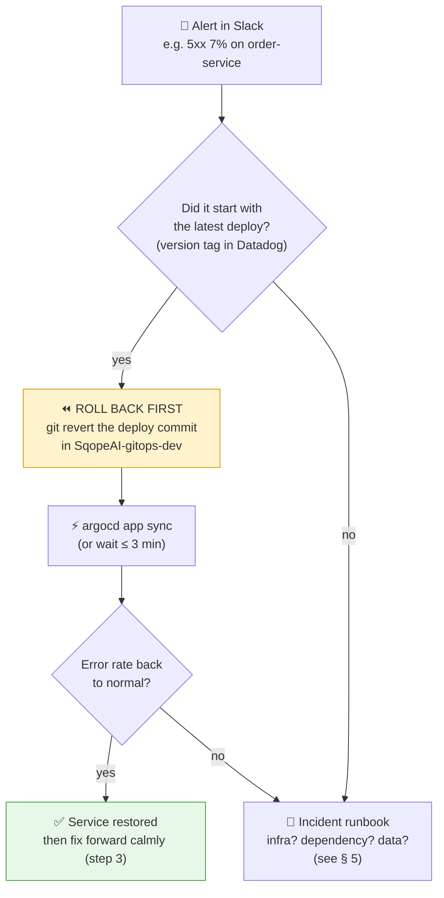
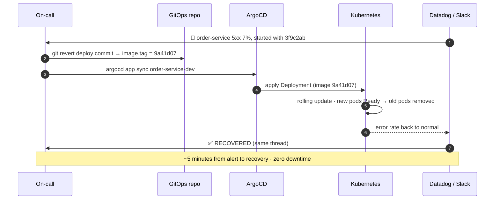
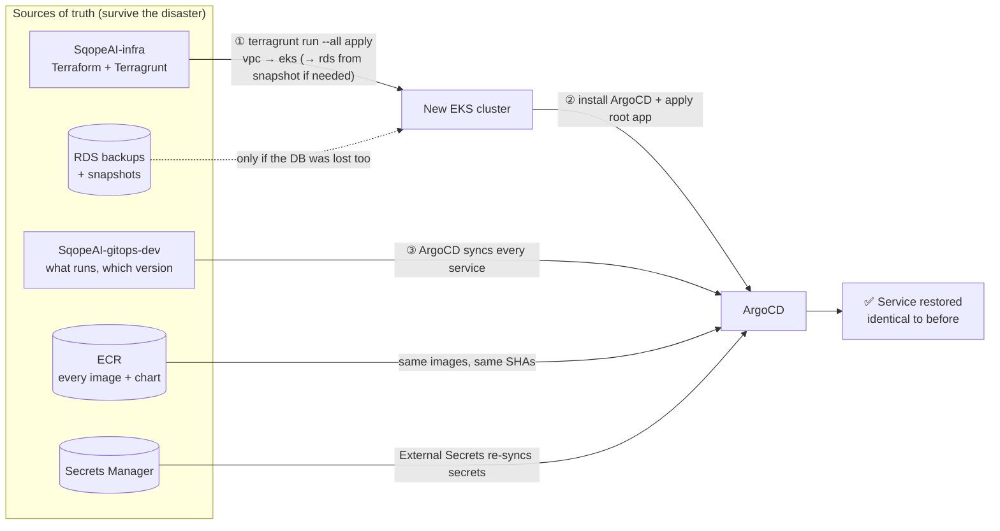

# Question 6: Disaster recovery

> **Assignment:** *"Explain how you would handle a failed deployment and restore service."*

**Answer: four layers.** Most failures are stopped by the first two layers automatically. The
ones that get through are undone with a **`git revert`**. Everything else can be **rebuilt from
git, ECR and backups**.



---

## Contents
1. [Recovery targets (RTO / RPO)](#1-recovery-targets-rto--rpo)
2. [Layer 1 · Prevent: failed builds never reach a cluster](#2-layer-1--prevent-failed-builds-never-reach-a-cluster)
3. [Layer 2 · Contain: a broken release can't take the service down](#3-layer-2--contain-a-broken-release-cant-take-the-service-down)
4. [Layer 3 · Revert: a new version is live and we need it gone, fast](#4-layer-3--revert-a-new-version-is-live-and-we-need-it-gone-fast)
5. [Layer 4 · Recover: data, infrastructure, a whole cluster or region](#5-layer-4--recover-data-infrastructure-a-whole-cluster-or-region)
6. [Failed infrastructure changes](#6-failed-infrastructure-changes)
7. [Practice: drills, runbooks and postmortems](#7-practice-drills-runbooks-and-postmortems)
8. [Already in place vs. next steps](#8-already-in-place-vs-next-steps)

---

## 1. Recovery targets (RTO / RPO)

**RTO** is how long until service is back. **RPO** is how much data we could lose.

| Scenario | What happens | RTO | RPO |
|---|---|---|---|
| A build is broken (tests, scan, smoke test fail) | CI blocks it. **Nothing is deployed.** | 0 (never down) | 0 |
| New version can't start or isn't ready | Rollout **stalls**, old pods keep serving | 0 (never down) | 0 |
| **New version is live but misbehaving** | **`git revert` in GitOps → ArgoCD rolls back** | **~5 min** | 0 |
| Pod or node dies | Kubernetes reschedules automatically | Seconds | 0 |
| An Availability Zone goes down | Pods in the other 2 AZs serve. RDS Multi-AZ fails over automatically. | ~1-2 min | 0 (synchronous standby) |
| Data deleted or corrupted (human error, bad migration) | RDS **point-in-time restore** | ~1 h | **≤ 5 min** |
| The EKS cluster is lost | Rebuild with Terragrunt, then ArgoCD redeploys everything from git | ~1-2 h | 0 (stateless; data is in RDS) |
| The whole AWS region is lost | Rebuild in a second region from IaC + replicated images + copied DB snapshots | ~4 h | ≤ 1 h |

These are the **proposed** targets for launch. They're realistic with the design below and get
verified by drills (§7).

---

## 2. Layer 1 · Prevent: failed builds never reach a cluster

A deployment that fails **in CI** is the cheapest kind. Every check runs before anything is pushed
([README-CICD](README-CICD.md)):

| Gate | Stops |
|---|---|
| ruff, hadolint | Obvious bugs, bad Dockerfiles |
| pytest with ≥ 80% coverage | Logic errors |
| **Smoke test of the real image** (read-only, non-root) | Images that can't start under Kubernetes conditions |
| Trivy | Images with fixable HIGH/CRITICAL CVEs |
| Chart: ct lint, kubeconform, render with real values | Manifests Kubernetes would reject |

**If any gate fails on `main`, nothing is pushed to ECR and the GitOps repo isn't touched.** Dev
keeps running the previous version. This has already happened for real: the first push to `main`
was **blocked by the Trivy gate** and fixed through [PR #1](https://github.com/gologolo24/SqopeAI/pull/1).

---

## 3. Layer 2 · Contain: a broken release can't take the service down

If a version passes CI but is broken in the cluster (bad config, a crash on start, a dependency it
can't reach), Kubernetes **contains** it:



| Setting | Effect | Where |
|---|---|---|
| `maxUnavailable: 0` | Old pods are removed **only after** new ones pass readiness | [values.yaml#L80-L83](chart/generic/values.yaml#L80-L83) |
| `readinessProbe` on `/readyz` | A pod that isn't ready gets **no traffic** | [deployment.yaml#L77-L82](chart/generic/templates/deployment.yaml#L77-L82) |
| `startupProbe` / `livenessProbe` | Slow starts are tolerated; hung processes are restarted | [deployment.yaml#L65-L76](chart/generic/templates/deployment.yaml#L65-L76) |
| PodDisruptionBudget + spread across 3 AZs | Node drains and AZ failures never take all replicas | [pdb.yaml](chart/generic/templates/pdb.yaml) |

**Result:** a release that can't start is a **non-event for users**. The team gets an alert, and
the fix is the same `git revert` as below. There's no outage to recover from.

---

## 4. Layer 3 · Revert: a new version is live and we need it gone, fast

The hardest case: the new version **started fine and passed its probes**, but it's wrong. Errors
went up, a feature is broken, or latency jumped. Users are affected, so it has to be reverted
**now**.

### How we know it's the new version

Every metric, log and trace is tagged with **`version` = the git commit SHA**
([README-MONITORING § 4](README-MONITORING.md#4-unified-tagging-env-service-version--commit-sha)).
The Slack alert says *"started right after deploy 3f9c2ab"*, and Datadog's Deployment Tracking
shows the error rate split by version. **Deciding to roll back takes about a minute.**

### The decision



> **Rule: roll back first, debug later.** Rolling back to a known-good version is safe and takes
> minutes. Debugging under pressure while users suffer is neither.

### Step 1: revert the deploy commit in the GitOps repo (about 1 minute)

Every deployment is **one commit** in [SqopeAI-gitops-dev](https://github.com/gologolo24/SqopeAI-gitops-dev/commits/main),
created by CI with a predictable message
([main.yml#L173](.github/workflows/main.yml#L173)), so it's easy to find:

```bash
cd SqopeAI-gitops-dev && git pull

git log --oneline -5 -- apps/order-service/values.yaml
#   a1b2c3d deploy(order-service): 3f9c2ab   ← the bad release
#   9e8f7a6 deploy(order-service): 9a41d07   ← the last good one

git revert --no-edit a1b2c3d      # image.tag goes back to 9a41d07…
git push origin main
```

What this does:
- **The previous image is guaranteed to exist.** ECR tags are immutable, and the lifecycle policy
  keeps recent images. Nothing has to be rebuilt.
- **It's a normal commit.** It's audited, visible to everyone, and itself revertable.
- **It needs no cluster access.** Whoever is on call (Israel, Poland or Peru) can do it from
  anywhere with git. The GitHub web editor works too: change `image.tag` back to the previous SHA
  and commit.

### Step 2: make ArgoCD apply it now (seconds), then verify

ArgoCD polls git every 3 minutes, or instantly with a webhook. During an incident, don't wait:

```bash
argocd app sync order-service-dev
argocd app wait order-service-dev --health --timeout 300

# verify: /readyz reports the running version
kubectl -n order-service port-forward svc/order-service 8080:80 &
curl -s localhost:8080/readyz     # {"status":"ready","service":"order-service","version":"9a41d07…"}
```

The rollback is an ordinary **rolling update** (§3), so it has **no downtime**: pods running the
good version start, become ready, and only then are the bad pods removed. In Datadog, the error
rate drops and `version:9a41d07` takes all the traffic again. The ✅ recovery message lands in the
same Slack thread as the alert.



### Step 3: make the revert stick by fixing `main` in the app repo

The GitOps revert fixes the **cluster**, but `main` in SqopeAI still contains the bad code. The
**next merge** that touches order-service would build from it and deploy the bug again. So, right
after the rollback:

```bash
cd SqopeAI
git revert -m 1 <merge-commit-of-the-bad-PR>   # undo the change in the code
# open a PR → services-pr validates → merge → services-main deploys the good code as a new SHA
```

Then fix the actual bug properly in a new PR, with a test that reproduces it.

### Why not other rollback methods?

| Method | Why not (as the default) |
|---|---|
| `kubectl rollout undo` | ArgoCD **`selfHeal`** puts the cluster back to what git says within minutes, so the bad version would return ([applicationset.yaml#L46-L48](https://github.com/gologolo24/SqopeAI-gitops-dev/blob/main/argocd/applicationset.yaml#L46-L48)). Git must change, not the cluster. |
| `argocd app rollback` | ArgoCD refuses to roll back apps with auto-sync enabled. You'd have to disable auto-sync first, and git would no longer match the cluster. It's only a break-glass option if git itself is unavailable. |
| Rebuilding the old code in CI | Takes CI minutes, and produces a *new* artifact. Reverting to the **already tested, already scanned image** is faster and safer. |

### Watch out: database changes

A rollback only works if **the old code still works with the current database schema**. So
migrations follow the **expand / contract** pattern:
1. **Expand.** Add new columns and tables, without removing anything. Both versions work.
2. Deploy the new code that uses them.
3. **Contract.** Remove the old columns **in a later release**, once nobody will roll back past
   step 2.

That way **a code rollback never needs a data rollback.**

---

## 5. Layer 4 · Recover: data, infrastructure, a whole cluster or region

### Data: RDS PostgreSQL

| Protection | Setting (prod) | Covers | Where |
|---|---|---|---|
| **Multi-AZ** standby (synchronous) | `multi_az = true` | Instance or AZ failure: **automatic failover**, same endpoint, no data loss | [prod env.hcl#L26](https://github.com/gologolo24/SqopeAI-infra/blob/main/live/prod/env.hcl#L26) |
| **Automated backups + point-in-time restore** | `backup_retention_days = 30` | Human error, bad migration, corruption: restore to **any second** in the last 30 days | [prod env.hcl#L27](https://github.com/gologolo24/SqopeAI-infra/blob/main/live/prod/env.hcl#L27) |
| **Deletion protection + final snapshot** | `deletion_protection = true` | Accidental `terraform destroy` or deletion from the console | [rds main.tf#L51-L54](https://github.com/gologolo24/SqopeAI-infra/blob/main/modules/rds/main.tf#L51-L54) |

**Restoring after bad data** (e.g. a migration deleted rows at 14:02):
1. Restore to a **new** instance at 14:01 (point-in-time restore). The broken DB stays as
   evidence.
2. Verify the data on the restored instance.
3. Point the service at it. The DB endpoint lives in the service's secret, so this is a secret
   update (question 4) plus a restart: still a reviewed, recorded change.
4. Later, codify the new instance in Terraform (or import it) so code and reality match again.

### Infrastructure and the whole cluster: rebuilt from git

Nothing in the cluster is hand-made. Everything is **code in git**, so a lost cluster is
**rebuilt, not repaired**:



| Step | Command / action | Time |
|---|---|---|
| ① Infrastructure | `terragrunt run --all apply --working-dir live/prod` (VPC, EKS; RDS is untouched unless it was lost too) | ~20-30 min (mostly EKS creation) |
| ② Bootstrap | Install ArgoCD, then `kubectl apply -f bootstrap/root-app.yaml` ([root-app](https://github.com/gologolo24/SqopeAI-gitops-dev/blob/main/bootstrap/root-app.yaml)) | ~5 min |
| ③ Applications | ArgoCD deploys **every service at exactly the version in git**. External Secrets re-creates the secrets from Secrets Manager. | ~5-10 min |
| ④ Traffic | DNS / load balancer points at the new cluster | minutes |

The application layer is **stateless** (all state is in RDS), so a rebuilt cluster is
**identical** to the old one. That's the practical payoff of IaC + GitOps.

### A whole region (eu-central-1) lost: pilot-light plan

| Prepared in advance | Used in the disaster |
|---|---|
| ECR **cross-region replication** (images + chart) to `eu-west-1` | The images are already there |
| RDS snapshots **copied to `eu-west-1`** on a schedule (or a cross-region read replica) | Restore or promote the DB, RPO ≤ 1 h (minutes with a replica) |
| Secrets Manager **replica secrets** in `eu-west-1` | External Secrets reads them |
| Terragrunt: `region` is a value in `env.hcl` | Copy `live/prod` → `live/prod-dr`, set `region = "eu-west-1"`, apply |
| Route 53 health checks + failover records | Traffic moves when the primary is unhealthy |

The Terraform state bucket is versioned, and the state itself is replicated to the second region,
so Terraform keeps working even when the primary region is down.

---

## 6. Failed infrastructure changes

| Protection | How |
|---|---|
| **Plan before apply** | Every PR shows the plan for dev, staging **and prod** (TeamCity). A destructive change is visible *before* merging. |
| **Promotion** | dev → staging apply automatically. Prod is a **manual** step, applying the same commit that already succeeded twice. |
| **Small blast radius** | One state per env × component: a bad `eks` change can't touch `rds`, and dev can't touch prod |
| **Revert** | `git revert` the infra commit → TeamCity applies the previous configuration |
| **Corrupted state** | The S3 state bucket is **versioned**: restore the previous state file version |
| **Guard rails** | `allowed_account_ids` (no applying to the wrong account), deletion protection on staging and prod databases |

Details: [SqopeAI-infra README](https://github.com/gologolo24/SqopeAI-infra#6-teamcity-how-changes-reach-aws).

---

## 7. Practice: drills, runbooks and postmortems

A DR plan that's never tested is a guess. So:

| Practice | How often | What |
|---|---|---|
| **Rollback drill** | Monthly, in staging | Deploy a deliberately broken version, then roll back with the runbook above. **Measure time to recovery.** |
| **Restore drill** | Quarterly | Point-in-time restore of the prod DB into a scratch instance, and verify the data. *A backup that was never restored is not a backup.* |
| **Rebuild drill** | Twice a year | Rebuild the staging cluster from scratch (Terragrunt + ArgoCD) and time it against the RTO |
| **Game day / chaos** | Quarterly | Kill nodes, block an AZ, fail RDS over, and check that alerts fire and the service survives |
| **Runbooks** | Always current | Linked from every alert ([README-MONITORING § 7](README-MONITORING.md#7-alerting-to-slack)): this document is the rollback runbook |
| **Blameless postmortem** | After every P1 | Timeline (from git, ArgoCD and Datadog), root cause, and **action items to prevent the class of failure**, not just the instance |

**Incident communication:** the alert's Slack thread is the incident log. Status updates go to a
status page for customers. The on-call follows the sun (Israel → Poland → Peru), so hand-over
happens in the thread.

---

## 8. Already in place vs. next steps

| ✅ Already in place (in code) | ⏭️ Next step |
|---|---|
| CI gates block bad builds; failures on `main` deploy nothing | **Argo Rollouts canary** with Datadog analysis: send 10% of traffic to the new version, **auto-rollback** if errors rise (no human needed) |
| Rolling updates with `maxUnavailable: 0`, readiness / startup / liveness probes, PDB, AZ spread | ArgoCD webhook for instant sync (no `argocd app sync` needed) |
| Every deploy = one GitOps commit → rollback = `git revert` | A deploy freeze switch for a service during an incident |
| Immutable SHA-tagged images: every previous version stays available | ECR cross-region replication; cross-region RDS snapshot copies |
| `/readyz` reports the running version (to verify a rollback) | Route 53 failover; a pilot-light `prod-dr` in `eu-west-1` |
| RDS Multi-AZ, 30-day PITR, deletion protection (prod) | Scheduled restore and rebuild drills |
| The whole platform is code: Terragrunt (infra) + ArgoCD root app (apps) | AWS Backup vault lock (immutable, ransomware-proof backups) |
