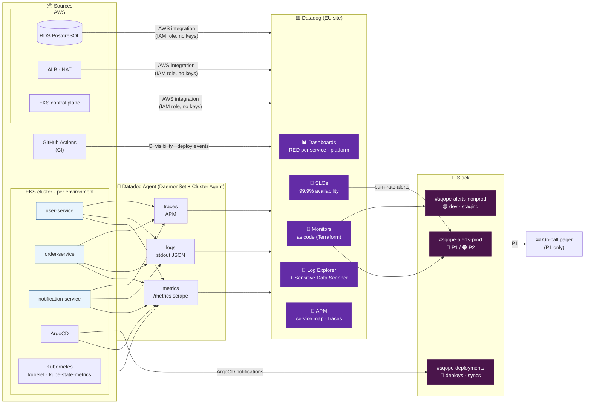
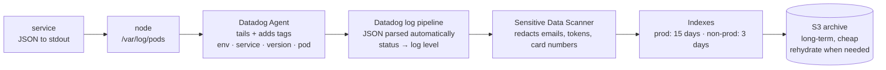
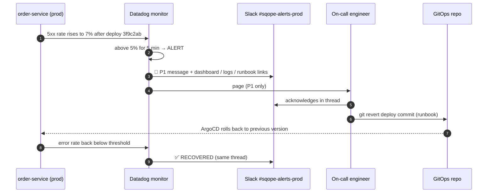

# Question 5: Monitoring, logging and alerting

> **Assignment:** *"Implement or propose monitoring, logging and alerting."*

**Answer: Datadog for all three signals, with alerts routed to Slack.**

| Signal | What we collect | How |
|---|---|---|
| **Metrics** | RED metrics per service (rate, errors, duration), business metrics, Kubernetes, AWS (RDS, ALB, NAT) | Datadog Agent scrapes each pod's `/metrics` (already exposed), plus kube-state-metrics and the AWS integration |
| **Logs** | Structured JSON from every container | The Datadog Agent tails stdout. The services already log JSON, so nothing needs parsing. |
| **Traces** | Request flow and latency across services | Datadog APM, injected automatically by the Agent (no code change) |
| **Alerts** | Monitors and SLOs on the above | Defined **as code** (Terraform), sent to **Slack** channels by severity, with P1s also paging on-call |

The key idea: **every metric, log and trace carries the same tags, `env`, `service` and
`version`, where `version` is the git commit SHA.** When an alert fires, Datadog shows exactly
which deployment introduced the problem.

---

## Contents
1. [The big picture](#1-the-big-picture)
2. [What the services already provide](#2-what-the-services-already-provide)
3. [Collecting: the Datadog Agent on EKS](#3-collecting-the-datadog-agent-on-eks)
4. [Unified tagging: env, service, version = commit SHA](#4-unified-tagging-env-service-version--commit-sha)
5. [Logging](#5-logging)
6. [Dashboards and SLOs](#6-dashboards-and-slos)
7. [Alerting to Slack](#7-alerting-to-slack)
8. [Monitors as code](#8-monitors-as-code)
9. [On-call across three time zones](#9-on-call-across-three-time-zones)
10. [Already in the code vs. next steps](#10-already-in-the-code-vs-next-steps)

---

## 1. The big picture



**How to read it:**
- **Left (sources):** the three services, the cluster, ArgoCD, the AWS managed services and CI.
- **Middle:** one **Datadog Agent** per node collects metrics, logs and traces. A **Cluster Agent**
  adds cluster-level data. AWS services report through the Datadog **AWS integration**, which uses
  a cross-account IAM role, so there are no keys (question 4).
- **Right:** Datadog evaluates **monitors and SLOs** and posts to **Slack**. The channel depends on
  severity and environment, and P1s also page the on-call engineer. ArgoCD posts deployment events
  to their own channel.

---

## 2. What the services already provide

The services were built to be observed. These parts are **already implemented**:

| Already in the code | Where | Used for |
|---|---|---|
| `http_requests_total{method, route, status}` | [order-service main.py#L24](services/order-service/app/main.py#L24) | Request rate and error rate |
| `http_request_duration_seconds{method, route}` (histogram) | [main.py#L25](services/order-service/app/main.py#L25) | Latency percentiles |
| `orders_created_total` | [main.py#L26](services/order-service/app/main.py#L26) | **Business** metric: alert if orders stop |
| `notifications_queued_total{channel}` | [notification-service main.py#L27](services/notification-service/app/main.py#L27) | Business metric per channel (email, SMS, Slack) |
| `route` label = the route **template** (`/orders/{order_id}`), not the raw URL | [main.py#L37-L38](services/order-service/app/main.py#L37-L38) | Keeps metric cardinality (and Datadog cost) under control |
| JSON access log per request: `method`, `route`, `status`, `duration_ms` | [main.py#L41-L50](services/order-service/app/main.py#L41-L50) | Searchable logs without parsing |
| Health checks excluded from logs | [main.py#L16](services/order-service/app/main.py#L16) | No noise, lower log cost |
| `/healthz`, `/readyz` | [main.py#L54-L63](services/order-service/app/main.py#L54-L63) | Kubernetes probes and Datadog **Synthetic** checks |
| `/readyz` returns the running `version` (commit SHA) | [main.py#L60-L63](services/order-service/app/main.py#L60-L63) | Confirms which build is live |

---

## 3. Collecting: the Datadog Agent on EKS

The Agent is installed **through GitOps, like everything else**: the Datadog Operator and a
`DatadogAgent` resource, deployed by ArgoCD (the "platform" component listed in the
[infra repo's next steps](https://github.com/gologolo24/sqope-ai-infra#9-not-included-on-purpose-and-next-steps)).

```yaml
apiVersion: datadoghq.com/v2alpha1
kind: DatadogAgent
metadata:
  name: datadog
  namespace: datadog
spec:
  global:
    site: datadoghq.eu                 # EU data residency, next to eu-central-1
    clusterName: sqope-ai-prod
    tags: ["env:prod"]
    credentials:                       # synced from AWS Secrets Manager by External Secrets (question 4)
      apiSecret: { secretName: datadog-secret, keyName: api-key }
      appSecret: { secretName: datadog-secret, keyName: app-key }
  features:
    logCollection:
      enabled: true
      containerCollectAll: true        # every container's stdout
    apm:
      enabled: true
    admissionController:
      enabled: true                    # injects DD_ENV / DD_SERVICE / DD_VERSION and the APM library
    kubeStateMetricsCore:
      enabled: true                    # deployments, restarts, pending pods...
    orchestratorExplorer:
      enabled: true
```

| Decision | Why |
|---|---|
| **The Datadog API key lives in Secrets Manager**, synced by External Secrets | Same secret rule as everything else: never in git, never in Helm values ([README-SECURITY](README-SECURITY.md#3-from-secrets-manager-into-the-pod-external-secrets)) |
| **EU site** (`datadoghq.eu`) | Data stays in the EU, next to the workloads (GDPR) |
| **APM via the admission controller** | Traces with **no change to the Dockerfile or code**. The Agent injects the Python tracer when the pod starts. |
| **Metrics from the existing `/metrics`** | One annotation per service in the GitOps values. The app keeps exposing plain Prometheus metrics, so it isn't tied to a vendor. |

Each service turns on scraping with **one annotation** in its GitOps values file (the chart already
supports `podAnnotations`):

```yaml
# sqope-ai-gitops-dev/apps/order-service/values.yaml
podAnnotations:
  ad.datadoghq.com/order-service.checks: |
    {"openmetrics": {"instances": [{
      "openmetrics_endpoint": "http://%%host%%:8080/metrics",
      "namespace": "sqope",
      "metrics": ["http_requests", "http_request_duration_seconds", "orders_created"]
    }]}}
```

The metrics are **listed explicitly**. Only what we use is ingested, which keeps the Datadog bill
predictable.

---

## 4. Unified tagging: env, service, version = commit SHA

This is what turns three separate data streams into one story. Every metric, log and trace is
tagged with:

| Tag | Value | Comes from |
|---|---|---|
| `env` | `dev` / `staging` / `prod` | The cluster / GitOps repo |
| `service` | `order-service` | The Helm release name |
| `version` | **`3f9c2ab…` (the git commit SHA)** | `image.tag`, written by CI into the GitOps repo |

In the chart this is three pod labels, which the Datadog admission controller turns into
`DD_ENV`, `DD_SERVICE` and `DD_VERSION`:

```yaml
# chart/generic/templates/deployment.yaml (pod template labels)
tags.datadoghq.com/env: {{ .Values.environment | quote }}
tags.datadoghq.com/service: {{ include "generic.fullname" . }}
tags.datadoghq.com/version: {{ .Values.image.tag | quote }}   # the commit SHA
```

**Why it matters:**
- An error-rate graph **split by `version`** shows instantly that errors started with build
  `3f9c2ab`.
- Datadog's **Deployment Tracking** compares the new version with the previous one (error rate,
  latency) automatically.
- From an alert you can jump to the **logs and traces of the same service, env and version** with
  one click.
- Rolling back means `git revert` in the GitOps repo
  ([README-CICD § 9](README-CICD.md#9-when-something-fails)). Datadog then shows the old
  `version` taking traffic again.

---

## 5. Logging



| Practice | Why |
|---|---|
| **JSON to stdout** (already the case) | No log files in containers (the root filesystem is read-only), and no regex parsing |
| **Agent adds Kubernetes and unified tags** | `service:order-service env:prod version:3f9c2ab` is filterable on every line |
| **Sensitive Data Scanner** | A second safety net on top of "log IDs, not personal data" ([README-SECURITY § 7](README-SECURITY.md#7-sensitive-data)) |
| **Retention per environment + S3 archive** | Hot search for recent incidents, cheap long-term storage for audits |
| **Exclusion filters** (health checks, debug logs in prod) | Controls cost. The services already skip `/healthz` and `/readyz`. |
| **Log-based metrics** (e.g. count of `level:error` per service) | Alert on error-log spikes without indexing every line forever |

---

## 6. Dashboards and SLOs

| Dashboard | Shows |
|---|---|
| **Service overview** (one template, filtered by `service`) | **RED**: requests/s, error %, p50/p95/p99 latency, by route and by `version`, with **deploy markers** |
| **Business** | Orders created per minute, notifications queued per channel |
| **Platform** | Nodes, pod restarts, pending pods, HPA replicas, ALB 5xx, NAT bytes |
| **Database** | RDS CPU, connections, free storage, read/write latency, replica lag |
| **Delivery** | CI duration and failures (CI Visibility), ArgoCD sync status, deploys per day |

**SLOs** say what "good" means, and **burn-rate alerts** fire when we're using up the error
budget too fast. That's more meaningful than raw thresholds:

| SLO | Target (30 days) | Fast burn (page) | Slow burn (Slack) |
|---|---|---|---|
| order-service availability (non-5xx share of requests) | **99.9%** | Budget burning **14×** faster than allowed, over 1 h | 2× over 6 h |
| order-service latency (p95 < 300 ms) | 99% | 14× over 1 h | 2× over 6 h |
| Public API reachable (Synthetic test on `/readyz`) | 99.9% | Failing from 2+ locations | |

**Synthetic tests** call `/readyz` through the public load balancer every minute from **Frankfurt,
Tel Aviv and São Paulo**, close to the team and users in Israel, Poland and Peru. They catch DNS,
TLS and load-balancer problems that in-cluster metrics can't see.

---

## 7. Alerting to Slack

### Severity → channel routing

| Severity | Meaning | Examples | Goes to |
|---|---|---|---|
| 🔴 **P1** critical | Users affected **now** | SLO fast burn; 5xx > 5% for 5 min; Synthetic failing from 2+ locations; RDS down | **#sqope-alerts-prod** with `@here` **+ pages on-call** |
| 🟠 **P2** warning | Will hurt soon | p95 latency high for 10 min; RDS free storage < 20%; pods restarting; replicas unavailable | **#sqope-alerts-prod** |
| 🟡 **P3** non-prod | Dev or staging broken | Same monitors with `env:dev` / `env:staging` | **#sqope-alerts-nonprod** |
| 🔵 **Info** | Not a problem | Deploy finished, ArgoCD synced, chart released | **#sqope-deployments** |

### What a Slack alert looks like

```text
🔴 [P1][prod] order-service: 5xx error rate 7.4% (threshold 5%)

service: order-service   env: prod   version: 3f9c2ab
Started 4 min ago, right after deploy 3f9c2ab (ArgoCD sync 09:14 UTC)

📊 Dashboard: Service overview · order-service · prod
🔎 Logs: service:order-service env:prod status:error (last 15 min)
📖 Runbook: README-CICD.md#9-when-something-fails  (rollback = git revert the deploy commit)
@here @oncall-platform
```

Every alert **answers the first three questions on its own**: *what* is broken, *since when /
which version*, and *what to do* (runbook link). Nobody has to dig before acting.

### Alert lifecycle



**Alert hygiene** (so people don't learn to ignore Slack):
- **Few alerts, each one actionable.** If nobody needs to act, it's a dashboard, not an alert.
- **Warning before critical** thresholds, so P2 gives time to act before P1.
- **Recovery messages** go to the same thread, which closes the loop.
- **`notify_no_data`** on critical monitors: a service that goes silent is also an incident.
- **Monthly review** of noisy alerts: tune them or delete them.

---

## 8. Monitors as code

Monitors and SLOs live in **Terraform** (the Datadog provider, in the infra repo). They're
reviewed in PRs and identical across environments. Nobody clicks alerts together in the UI. The
Slack routing is simply the `@slack-…` handle in the message:

```hcl
resource "datadog_monitor" "high_error_rate" {
  for_each = toset(["user-service", "order-service", "notification-service"])

  name  = "[prod] ${each.key}: high 5xx error rate"
  type  = "query alert"
  query = <<-EOQ
    sum(last_5m):(
      sum:trace.fastapi.request.errors{env:prod,service:${each.key}}.as_count() /
      sum:trace.fastapi.request.hits{env:prod,service:${each.key}}.as_count()
    ) * 100 > 5
  EOQ

  monitor_thresholds {
    warning  = 2
    critical = 5
  }

  message = <<-EOT
    {{#is_alert}}🔴 [P1][prod] ${each.key}: 5xx error rate {{value}}% (threshold 5%) @slack-sqope-alerts-prod @here @pagerduty-sqope-oncall{{/is_alert}}
    {{#is_warning}}🟠 [P2][prod] ${each.key}: 5xx error rate {{value}}% @slack-sqope-alerts-prod{{/is_warning}}
    {{#is_recovery}}✅ ${each.key}: error rate back to normal @slack-sqope-alerts-prod{{/is_recovery}}
    Runbook: https://github.com/gologolo24/SqopeAI/blob/main/README-CICD.md#9-when-something-fails
  EOT

  notify_no_data    = true
  no_data_timeframe = 10
  renotify_interval = 30
  tags              = ["env:prod", "service:${each.key}", "team:platform", "managed-by:terraform"]
}
```

The same pattern covers the rest of the monitor set:

| Monitor | Signal |
|---|---|
| p95 latency high | APM `trace.fastapi.request` latency distribution |
| **Orders stopped** | `sqope.orders_created.count` anomaly / zero for 15 min in business hours (a business alert, not a technical one) |
| Pods restarting / CrashLoopBackOff | `kubernetes.containers.restarts`, kube-state-metrics |
| Deployment replicas unavailable | `kubernetes_state.deployment.replicas_unavailable > 0` for 10 min |
| RDS CPU, connections, free storage | AWS integration (`aws.rds.*`) |
| ArgoCD app degraded / out of sync too long | ArgoCD metrics |
| Error-log spike | Log-based metric, anomaly detection |

---

## 9. On-call across three time zones

The team is in **Israel, Poland and Peru**, which naturally gives **follow-the-sun** coverage with
no one on call at night:

| UTC | Primary on-call |
|---|---|
| 05:00 - 13:00 | 🇮🇱 Israel |
| 13:00 - 21:00 | 🇵🇱 Poland |
| 21:00 - 05:00 | 🇵🇪 Peru |

- **P1 pages** go to whoever is on shift (PagerDuty or Opsgenie, integrated with Datadog and
  Slack).
- **P2/P3** wait in Slack for business hours.
- **Hand-over** happens in the alert threads: the open threads in `#sqope-alerts-prod` are the
  shift summary.

---

## 10. Already in the code vs. next steps

| ✅ Already in the code | ⏭️ Next step |
|---|---|
| RED + business metrics on `/metrics` in all 3 services, with low-cardinality route labels | Datadog Operator + `DatadogAgent` via ArgoCD (infra `platform` component) |
| Structured JSON logs to stdout, health checks excluded | Datadog API key in Secrets Manager → External Secrets |
| `/healthz` + `/readyz` (with the running version) | Synthetic tests from Frankfurt, Tel Aviv and São Paulo |
| Chart supports `podAnnotations` (Datadog autodiscovery) and `podLabels` | Unified-service-tagging labels in the chart (`version` = `image.tag`) |
| Image tag = commit SHA, end to end | Monitors, SLOs and dashboards in Terraform (Datadog provider) |
| GitOps deploys, rollback = `git revert` (the runbook action) | Slack integration (3 channels) + PagerDuty for P1; ArgoCD notifications → `#sqope-deployments` |
