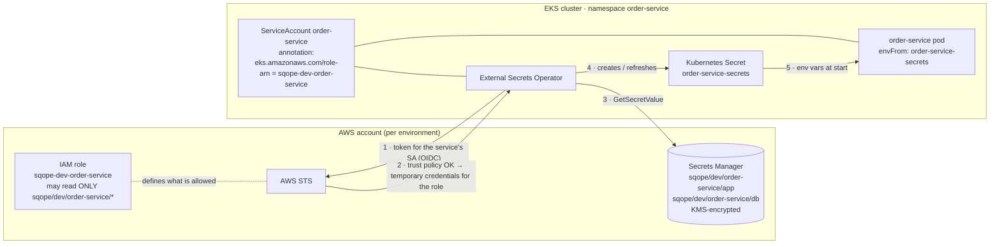
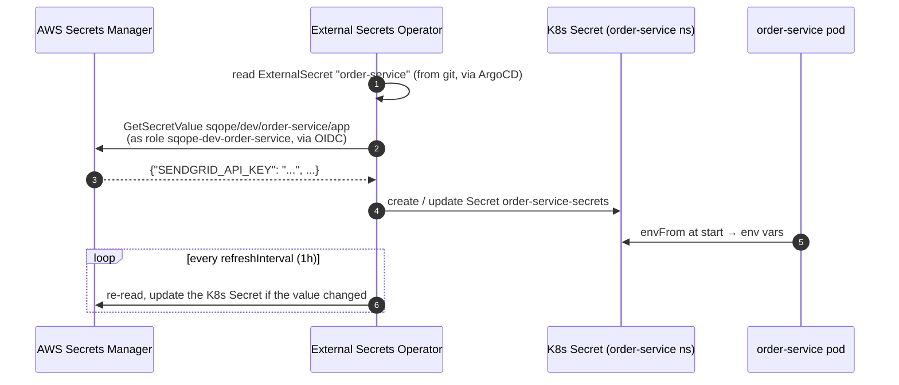
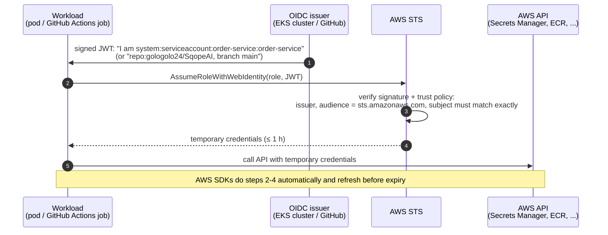

# Question 4: Security

> **Assignment:** *"Explain how you would manage secrets, access permissions, credentials and
> sensitive data."*

**Answer: four rules, applied everywhere.**

| # | Rule | In one line |
|---|---|---|
| 1 | **Secrets live in one place: AWS Secrets Manager** | Never in git, Docker images, Helm values, CI variables or Terraform code |
| 2 | **External Secrets Operator brings them into Kubernetes** | It syncs Secrets Manager → a Kubernetes Secret, which the pod reads as env vars |
| 3 | **No long-lived keys: trust is based on OIDC** | GitHub Actions, pods and CI agents get **short-lived** credentials by proving *who they are*, not by holding a key |
| 4 | **Least privilege per identity: one IAM role per service** | Each service's ServiceAccount is **annotated with its own IAM role**, which can read only that service's secrets and resources |

---

## Contents
1. [The big picture](#1-the-big-picture)
2. [Secrets: AWS Secrets Manager](#2-secrets-aws-secrets-manager)
3. [From Secrets Manager into the pod: External Secrets](#3-from-secrets-manager-into-the-pod-external-secrets)
4. [Credentials: OIDC trust instead of keys](#4-credentials-oidc-trust-instead-of-keys)
5. [Permissions: one IAM role per service](#5-permissions-one-iam-role-per-service)
6. [People: how engineers get access](#6-people-how-engineers-get-access)
7. [Sensitive data](#7-sensitive-data)
8. [Guardrails in CI/CD](#8-guardrails-in-cicd)
9. [If a secret leaks](#9-if-a-secret-leaks)
10. [Already in the code vs. next steps](#10-already-in-the-code-vs-next-steps)

---

## 1. The big picture



**What the diagram shows:**
- The secret's value exists in **Secrets Manager** and in a **Kubernetes Secret inside the
  service's own namespace**, nowhere else.
- No component in the chain holds an AWS access key. Each step proves its identity with an
  **OIDC token** and receives credentials that expire within the hour.
- The IAM role can read **only its own service's secrets**. Even if order-service were
  compromised, it couldn't read notification-service's API keys.

---

## 2. Secrets: AWS Secrets Manager

**Every** secret lives in AWS Secrets Manager, in the account of its environment: database
credentials, third-party API keys (email or SMS provider, Slack), signing keys.

**Naming convention:** `sqope/<env>/<service>/<name>`

| Secret | Contains | Created by |
|---|---|---|
| `sqope/prod/order-service/db` | `DB_USER`, `DB_PASSWORD` (the service's **own** DB user, not the master user) | A DB migration job; rotated by Secrets Manager |
| `sqope/prod/notification-service/app` | `SENDGRID_API_KEY`, `SLACK_WEBHOOK_URL` | The platform team, out-of-band (console / CLI), **never typed into Terraform** |
| RDS master password | Admin credentials, for break-glass and migrations only | **AWS itself**, through `manage_master_user_password = true` ([infra rds module](https://github.com/gologolo24/sqope-ai-infra/blob/main/modules/rds/main.tf#L45)). The password never exists in code, state outputs or CI. |

Each environment has its own account, so dev, staging and prod secrets are **physically
separate**. A dev role can't even see that prod secrets exist.

**Why Secrets Manager?**

| Need | How Secrets Manager provides it |
|---|---|
| Encryption | Encrypted at rest with **KMS**. Decrypting requires *both* Secrets Manager and KMS permissions. |
| Audit | **CloudTrail logs every `GetSecretValue`**: which role read which secret, and when |
| Rotation | Built-in rotation (managed rotation for RDS, Lambda for the rest) with no app changes |
| Access control | IAM policies per secret path, the same model as all other AWS permissions |
| Versioning | Older versions stay available, so a bad rotation can be rolled back |

**Alternatives considered:**
- **Kubernetes Secrets in git**: base64 isn't encryption, so this is never acceptable.
- **Sealed Secrets / SOPS**: encrypted in git, but rotation and audit are harder, and the secret
  still lives in git history forever.
- **HashiCorp Vault**: very capable, but it's another critical system to run. On AWS, Secrets
  Manager covers our needs as a managed service.

---

## 3. From Secrets Manager into the pod: External Secrets

[External Secrets Operator](https://external-secrets.io) (ESO) runs in the cluster. It reads
secrets from Secrets Manager and writes them as ordinary Kubernetes Secrets. Applications stay
cloud-agnostic: they just read environment variables.



**The manifests, per service.** Both are deployed by ArgoCD like everything else. They contain
**only the secret's name, never its value**, so they're safe in git:

```yaml
# SecretStore: "talk to Secrets Manager AS THIS SERVICE"; ESO borrows the service's own identity
apiVersion: external-secrets.io/v1
kind: SecretStore
metadata:
  name: aws-secrets-manager
  namespace: order-service
spec:
  provider:
    aws:
      service: SecretsManager
      region: eu-central-1
      auth:
        jwt:
          serviceAccountRef:
            name: order-service        # → uses the IAM role annotated on this ServiceAccount
---
# ExternalSecret: "which secret, and which Kubernetes Secret to write it to"
apiVersion: external-secrets.io/v1
kind: ExternalSecret
metadata:
  name: order-service
  namespace: order-service
spec:
  refreshInterval: 1h
  secretStoreRef:
    kind: SecretStore
    name: aws-secrets-manager
  target:
    name: order-service-secrets        # the Kubernetes Secret ESO creates
  dataFrom:
    - extract:
        key: sqope/dev/order-service/app   # every JSON key becomes one env var
```

**The pod side is already in the chart.** Listing the Secret in the service's values file loads it
as environment variables ([values.yaml#L30-L33](chart/generic/values.yaml#L30-L33),
[deployment.yaml#L58-L64](chart/generic/templates/deployment.yaml#L58-L64)):

```yaml
# sqope-ai-gitops-dev/apps/order-service/values.yaml
envFromSecrets:
  - order-service-secrets
```

**Design choices:**
- **A namespaced SecretStore that uses the service's own ServiceAccount**, rather than one
  cluster-wide store with a powerful "read everything" role. ESO can then only fetch what *that
  service* is allowed to read, so least privilege holds even for the sync itself.
- **`refreshInterval: 1h`.** A rotated secret reaches the cluster within an hour.
  [Stakater Reloader](https://github.com/stakater/Reloader) then performs a rolling restart of the
  pods that use the changed Secret, because env vars are only read at start.
- **The Kubernetes Secret is owned by ESO.** Deleting the ExternalSecret removes it, so no
  orphaned secrets are left behind.
- **etcd encryption:** EKS envelope-encrypts Kubernetes Secrets with a KMS key (the EKS module
  default in the infra repo).

---

## 4. Credentials: OIDC trust instead of keys

**The problem with keys:** an access key is a long-lived password. It can be copied, leaked in a
log or a commit, forgotten on a laptop, and has to be rotated by hand.

**The OIDC approach:** the caller presents a **signed, short-lived identity token** from a trusted
issuer (GitHub, or the EKS cluster). AWS checks the token against the role's **trust policy** and
returns credentials that **expire within an hour**. There is nothing to store, leak or rotate.



**Every machine identity in the platform, and how it authenticates:**

| Who | Needs | How it proves identity | Keys stored? | Where |
|---|---|---|---|---|
| **GitHub Actions** (main branch only) | Push images to ECR | GitHub OIDC token. The trust policy requires `repo:gologolo24/SqopeAI:ref:refs/heads/main`, so **PR builds and forks can't assume it** | ❌ none | [main.yml#L86-L91](.github/workflows/main.yml#L86-L91) |
| **cosign** (image signing) | Sign images | GitHub OIDC (keyless Sigstore) | ❌ no signing key | [main.yml#L119-L124](.github/workflows/main.yml#L119-L124) |
| **Each service's pods** | Their own AWS resources and secrets | **IRSA**: EKS OIDC token for the pod's ServiceAccount | ❌ none | chart `serviceAccount.annotations` (§5) |
| **External Secrets** | Read Secrets Manager | IRSA, **borrowing each service's ServiceAccount** | ❌ none | §3 |
| **TeamCity agents** (infra) | Run Terraform in env accounts | EC2 instance role → `AssumeRole` into `terraform-planner` (PRs) or `terraform-deployer` (main) | ❌ none | [infra root.hcl#L42-L48](https://github.com/gologolo24/sqope-ai-infra/blob/main/live/root.hcl#L42-L48) |
| **EKS nodes** | Pull images from ECR | Node IAM role (managed by the EKS module) | ❌ none | infra eks module |
| **Engineers** | Console, CLI, kubectl | SSO + MFA (§6) | ❌ none | |
| GitHub Actions → GitOps repo | Commit image tags | Deploy key scoped to **one repo**, stored in the `dev` GitHub Environment | ⚠️ one SSH key | [main.yml#L133-L151](.github/workflows/main.yml#L133-L151) |

The one key in the system is the **GitOps deploy key**. It can write to one git repo and nothing
else: no cloud access. The improvement is a **GitHub App**, whose tokens last about 1 hour. That's
listed as a next step.

---

## 5. Permissions: one IAM role per service

**The mechanism:** each service runs under **its own Kubernetes ServiceAccount**, which the shared
chart already creates, named after the service
([serviceaccount.yaml](chart/generic/templates/serviceaccount.yaml)). We **annotate that
ServiceAccount with the IAM role** the service should use. EKS injects the OIDC token into the pod,
and the AWS SDK picks it up automatically, with **no code changes and no keys**.

**Kubernetes side**, one line in the service's GitOps values file (the chart supports it today:
[values.yaml#L15-L18](chart/generic/values.yaml#L15-L18)):

```yaml
# sqope-ai-gitops-dev/apps/order-service/values.yaml
serviceAccount:
  annotations:
    eks.amazonaws.com/role-arn: arn:aws:iam::111111111111:role/sqope-dev-order-service
```

**AWS side**, one role per service in the infra repo. The **trust policy** says *who* may use the
role, and the **permission policy** says *what* it may do:

```hcl
# Trust: ONLY the order-service ServiceAccount, in the order-service namespace, of THIS cluster
data "aws_iam_policy_document" "order_service_trust" {
  statement {
    actions = ["sts:AssumeRoleWithWebIdentity"]
    principals {
      type        = "Federated"
      identifiers = [module.eks.oidc_provider_arn]           # this cluster's OIDC issuer
    }
    condition {
      test     = "StringEquals"
      variable = "${local.oidc_issuer}:sub"
      values   = ["system:serviceaccount:order-service:order-service"]
    }
    condition {
      test     = "StringEquals"
      variable = "${local.oidc_issuer}:aud"
      values   = ["sts.amazonaws.com"]
    }
  }
}

# Permissions: ONLY this service's secrets
data "aws_iam_policy_document" "order_service" {
  statement {
    actions   = ["secretsmanager:GetSecretValue", "secretsmanager:DescribeSecret"]
    resources = ["arn:aws:secretsmanager:eu-central-1:111111111111:secret:sqope/dev/order-service/*"]
  }
}
```

**The permission matrix.** Each service gets exactly what it needs:

| Service (ServiceAccount) | IAM role | Allowed | Not allowed |
|---|---|---|---|
| `user-service` | `sqope-<env>-user-service` | Read `sqope/<env>/user-service/*` | Everything else |
| `order-service` | `sqope-<env>-order-service` | Read `sqope/<env>/order-service/*`; later, send to the orders SQS queue | Other services' secrets and queues |
| `notification-service` | `sqope-<env>-notification-service` | Read `sqope/<env>/notification-service/*`; send e-mail via SES | Reading orders, users, the DB secret |
| External Secrets | *(uses each service's role, §3)* | Only what that service may read | A cluster-wide read-all role |

**Why per-service roles?**
- **Blast radius:** a compromised service can reach only its own secrets and resources.
- **Audit:** CloudTrail shows `sqope-dev-order-service` read a secret, not a generic shared role.
- **Ownership:** a team can change its service's permissions in a reviewed PR without touching
  anyone else's.

**Kubernetes permissions, the same principle:**
- **No Kubernetes API token in pods.** `automountServiceAccountToken: false` is the chart default
  ([deployment.yaml#L33](chart/generic/templates/deployment.yaml#L33)). The services never call
  the Kubernetes API. IRSA mounts its own token, which is valid for AWS only.
- **A namespace per service**, and the ArgoCD **AppProject** limits what can be deployed and where
  ([project.yaml](https://github.com/gologolo24/sqope-ai-gitops-dev/blob/main/argocd/project.yaml)).
- **Pods run restricted:** non-root, read-only filesystem, all capabilities dropped, seccomp
  ([README-DOCKER § 7](README-DOCKER.md#7-the-image-and-kubernetes-fit-together)).

---

## 6. People: how engineers get access

| Access | How | Principle |
|---|---|---|
| **AWS** | **IAM Identity Center (SSO)** with MFA, mapped to roles per account (`ReadOnly` everywhere, `Developer` in dev, `Admin` break-glass in prod) | No IAM users and no personal access keys. Leaving the company means one account to disable. |
| **Kubernetes** | **EKS access entries** map SSO roles to Kubernetes groups: view for everyone, edit in dev, admin only via break-glass | Same identity everywhere, nothing to distribute |
| **Deployments** | Through **git PRs only**. ArgoCD `selfHeal` reverts manual `kubectl` changes. | Every change is reviewed and recorded |
| **ArgoCD UI** | SSO. Read-only for most people, sync rights for on-call. | Visibility without power |
| **Infrastructure** | Through TeamCity: plan on PR, apply after merge, prod manually ([infra repo](https://github.com/gologolo24/sqope-ai-infra#6-teamcity-how-changes-reach-aws)) | Nobody runs `terraform apply` against prod from a laptop |
| **Secrets** | Engineers **don't read production secrets**. Only the service roles can. Break-glass access is logged by CloudTrail. | Need-to-know |

The team is spread across Israel, Poland and Peru, so access is **identity-based** (SSO). It
doesn't depend on office IP addresses, and works the same from any country.

---

## 7. Sensitive data

| Layer | Protection |
|---|---|
| **At rest** | KMS encryption everywhere: RDS storage, RDS backups and snapshots, EBS volumes, S3 (Terraform state), Secrets Manager, Kubernetes Secrets in etcd |
| **In transit** | TLS at the load balancer (ACM certificates). PostgreSQL connections over TLS (`rds.force_ssl`). AWS API calls over HTTPS. |
| **Network isolation** | The database sits in subnets **with no internet route**, reachable **only from the EKS node security group** ([infra rds module](https://github.com/gologolo24/sqope-ai-infra/blob/main/modules/rds/main.tf)) |
| **Database access** | Each service has its **own DB user** with rights only to its own schema. The master user is for break-glass and migrations only. |
| **Logs** | Structured JSON logs carry **IDs, not personal data**: `order_id`, `user_id`, never e-mails, card data or tokens ([example](services/order-service/app/main.py)) |
| **Backups** | Encrypted. Retention grows with the environment (1 / 7 / 30 days). Prod has deletion protection. |
| **Images** | **No secrets baked into images.** Config and secrets are injected at runtime ([README-DOCKER § 4](README-DOCKER.md#4-hardening-whats-in-the-image-and-what-isnt)). |
| **Audit** | CloudTrail (AWS API calls, including every secret read), EKS audit logs, VPC flow logs, the git history of every change |

---

## 8. Guardrails in CI/CD

| Guardrail | What it prevents | Where |
|---|---|---|
| **GitHub secret scanning + push protection** (on for all three repos) | A secret being committed: the push is **blocked** | GitHub repo settings |
| Workflow token **`contents: read` by default**; write scopes per job | A compromised step doing more than its job needs | [pr.yml](.github/workflows/pr.yml), [main.yml](.github/workflows/main.yml) |
| **The job that runs PR code has no `id-token` permission** | A malicious PR reaching AWS | [_service-ci.yml#L27-L29](.github/workflows/_service-ci.yml#L27-L29) |
| **Actions pinned to commit SHAs** + Dependabot | A hijacked action tag injecting code into the pipeline | every `uses:` line |
| **Trivy**: image CVEs (gate) + Kubernetes and Terraform misconfiguration | Vulnerable images and insecure manifests reaching an environment | [README-CICD § 3](README-CICD.md#3-pipeline-a-pull-request-services-pr) |
| **Signed images** (cosign) + SBOM + provenance | Running images that weren't built by our pipeline (enforced at admission with Kyverno, next step) | [main.yml#L110-L131](.github/workflows/main.yml#L110-L131) |
| **Terraform**: read-only role for plans, `allowed_account_ids` | A PR changing infrastructure, or applying to the wrong account | [infra root.hcl](https://github.com/gologolo24/sqope-ai-infra/blob/main/live/root.hcl) |

---

## 9. If a secret leaks

Because there is **one source of truth** and everything syncs from it, recovery is fast:

| Step | Action |
|---|---|
| 1 | **Rotate** the value in Secrets Manager (or revoke it at the provider) |
| 2 | ESO syncs the new value into the Kubernetes Secret (or force it immediately: `kubectl annotate externalsecret order-service force-sync=$(date +%s) --overwrite`) |
| 3 | Reloader rolls the pods, and the old value is no longer used anywhere |
| 4 | **CloudTrail** shows who read the secret and when, which scopes the investigation |
| 5 | If it leaked through git: push protection should have blocked it. If not, rotating (step 1) is the fix, because rewriting git history doesn't un-leak a secret. |

Most leak paths don't exist in the first place: **there are no long-lived AWS keys to leak**, and
the only static credential (the GitOps deploy key) can touch only one repo and can be revoked in
one click.

---

## 10. Already in the code vs. next steps

| ✅ Already in the code | ⏭️ Next step (same design, more YAML/HCL) |
|---|---|
| GitHub OIDC → AWS role for ECR push, no keys ([main.yml](.github/workflows/main.yml)) | Infra component: the GitHub OIDC provider + CI role (`live/shared/ecr`) |
| Keyless cosign signing, SBOM, provenance | Kyverno policy: run only signed images |
| Per-job workflow permissions; PR jobs have no cloud access | GitHub App instead of the GitOps deploy key |
| Chart: per-service ServiceAccount, **role annotation support**, `envFromSecrets`, no K8s API token | `SecretStore` + `ExternalSecret` templates in the chart; ESO install (infra `platform` component) |
| RDS password generated by AWS in Secrets Manager; DB reachable only from EKS nodes | Per-service IAM roles (IRSA) in the infra repo, plus Secrets Manager rotation |
| Terragrunt: assume-role only, read-only planner role, `allowed_account_ids` | Branch protection on `main` requiring `ci-result` + `chart-result` (see [README](README.md#enabling-the-full-pipeline-aws)) |
| Hardened, non-root, read-only containers; Trivy gates | NetworkPolicies between services; Pod Security Standards `restricted` on namespaces |
| Secret scanning + push protection and Dependabot alerts on all three repos | |
