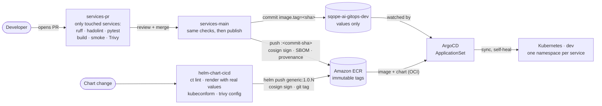

# Sqope AI: services, CI/CD and shared Helm chart

Sqope AI DevOps assignment. This repository holds the **application code**, the **CI/CD
pipelines** and the **shared Helm chart**. Deployment state lives in a separate GitOps repo that
ArgoCD watches.

**Assignment answers:**
- [Question 1: CI/CD](README-CICD.md): every pipeline, its stages, diagrams, and how ArgoCD
  handles the CD
- [Question 2: Infrastructure as Code](https://github.com/gologolo24/sqope-ai-infra): Terraform
  modules, Terragrunt environments, TeamCity, and the architecture diagram
- [Question 3: Docker](README-DOCKER.md): the layered multi-stage Dockerfile, image hardening,
  and how the image is deployed through CI and ArgoCD

| Repository | Holds | Changed by |
|---|---|---|
| **SqopeAI** (this repo) | 3 microservices, GitHub Actions pipelines, the `generic` Helm chart | Developers (PRs) |
| [**sqope-ai-gitops-dev**](https://github.com/gologolo24/sqope-ai-gitops-dev) | *Values only*: what runs in **dev** (image tag, replicas, resources), plus the ArgoCD ApplicationSet | CI (image tags) + platform (PRs) |
| [**sqope-ai-infra**](https://github.com/gologolo24/sqope-ai-infra) | Terraform modules + Terragrunt: VPC, EKS, RDS per environment (dev / staging / prod), deployed by TeamCity | Platform team |

**Why three repos?** Code, desired state and infrastructure change at different speeds, for
different reasons, by different people:
- **Code** changes many times a day. Each change is tested and produces an immutable image.
- **Desired state** (the GitOps repo) is the audit log of *what runs where*. A rollback is a
  `git revert`.
- **Infrastructure** changes rarely and needs the strictest review.

Splitting them means each gets its own access rules and review rules. A noisy app commit can never
change the cluster's shape, and a deploy never needs cloud admin rights.

---

## TL;DR

- **3 FastAPI microservices** live in `services/<name>/`: `user-service`, `order-service` and
  `notification-service`. Each exposes `/healthz`, `/readyz` and Prometheus `/metrics`, and
  writes JSON logs.
- **Pull request → `services-pr`**: CI runs **only for the services the PR touched**. Stages are
  ruff lint → hadolint → pytest (≥80% coverage) → docker build → container smoke test → Trivy
  scan.
- **Merge to main → `services-main`**: the same checks run, then CI:
  1. pushes the image to **ECR, tagged with the full commit SHA**
  2. signs it with **cosign**, and attaches an **SBOM** and **build provenance**
  3. commits the new tag to **sqope-ai-gitops-dev**, which **ArgoCD** then syncs to dev
- **Chart change → `helm-chart-cicd`**: one chart, `chart/generic`, serves every service.
  - It's validated against every real dev values file.
  - It's **versioned automatically** (MAJOR.MINOR.**patch+1**), pushed to **ECR as an OCI
    artifact**, and signed.
  - The GitOps repo only references the chart by its version.

---

## How a change reaches the cluster



---

## Repository layout

```
services/
  user-service/            FastAPI app (app/), tests (tests/), Dockerfile, pinned requirements
  order-service/           same structure: every service is self-contained and independently deployable
  notification-service/
chart/generic/             ONE Helm chart used by all services (secure defaults + values.schema.json)
  ci/                      test values used by ct lint (minimal + every feature enabled)
.github/
  workflows/pr.yml              services-pr: PR validation of touched services
  workflows/main.yml            services-main: validate → publish to ECR → deploy via GitOps
  workflows/_service-ci.yml     reusable: the CI stages for ONE service (used by both above)
  workflows/helm-chart-cicd.yml chart validation + versioned release to ECR
  actions/changed-services/     composite action: which services did this PR/push touch?
  scripts/chart-next-version.sh computes the next chart version from git tags
  dependabot.yml                weekly updates for pip, base images and action SHAs
  CODEOWNERS                    who must review what
ruff.toml                  one lint/format standard for all services
ct.yaml                    chart-testing config (ct lint in helm-chart-cicd)
.trivyignore               accepted vulnerability risks (each needs reason + expiry date)
```

---

## Pipelines

### What runs when

| Change | `services-pr` / `services-main` | `helm-chart-cicd` |
|---|---|---|
| PR touches `services/order-service/**` | **order-service only** (user and notification skipped) | skipped, `chart-result` is green |
| PR touches `chart/generic/**` | no service builds, `ci-result` is green | validate + print the version it would release |
| PR touches `ruff.toml` or a service workflow | **all 3 services** (shared config changed) | skipped |
| PR touches only docs | nothing runs, both gates are green | skipped |
| Merge to main touching `order-service` | validate → push `order-service:<sha>` → sign → bump tag in GitOps | skipped |
| Merge to main touching the chart | nothing | validate → release `generic:1.0.N` → cosign → git tag `generic-chart-v1.0.N` |

The list of services is **derived from the folders in `services/`**, so adding a fourth service
needs no pipeline change. The same is true on the GitOps side: a new `apps/<name>/` folder becomes a
new ArgoCD Application.

### Stage order, and why

| # | Stage | Why here |
|---|---|---|
| 1 | `ruff check` + `ruff format --check`, `hadolint` | Seconds to run. Most broken PRs fail here, before any build minutes are spent. |
| 2 | `pytest` with an 80% coverage gate | Fast, and catches logic errors before paying for an image build. |
| 3 | `docker build` (BuildKit, GHA layer cache) | Only code that passed lint and tests gets built. Cached layers keep it fast. |
| 4 | **Smoke test** the image (read-only FS, non-root) | pytest tests the *code*. This tests the *artifact* (missing files, wrong CMD, a dependency that only fails in the image), under the same constraints Kubernetes applies. |
| 5 | **Trivy** image scan | The results go to the GitHub Security tab, and the build **fails on fixable HIGH/CRITICAL** CVEs. Unfixable CVEs are reported but don't block, because blocking on something nobody can fix only teaches people to ignore the gate. |
| 6 | **Publish** (main only) | Pushes the **exact image that was scanned** (passed between jobs as an artifact, not rebuilt), then signs it and attaches the SBOM and provenance. |
| 7 | **GitOps bump** (main only) | One commit to `sqope-ai-gitops-dev` for all services in the merge, with links back to the source commit and run. |

### Least privilege per job

- The job that **runs PR code** (lint, tests, build) has `contents: read` and
  `security-events: write`, and **no cloud credentials at all**. A malicious test in a PR can't
  reach AWS.
- Only the `publish` job (main only) gets `id-token: write`, which it uses for the AWS OIDC role
  and keyless signing.
- Only `update-gitops` can read the GitOps deploy key. It runs in the **GitHub Environment `dev`**,
  which only `main` is allowed to use.

---

## Design decisions

| Decision | Why | Alternatives considered | Trade-off |
|---|---|---|---|
| **Monorepo for services**, separate GitOps and infra repos | One place for code and pipelines, with shared lint rules. Desired state and infra get their own access control and audit trail. | Repo per service (overhead for 3 small services); everything in one repo (app commits could change infra) | Monorepo CI must detect which service changed. Solved with path filters. |
| **Path-filtered dynamic matrix** + **reusable workflow** | Build and test only what changed (fast feedback for a team spread across 3 timezones). The stages are defined once, in `_service-ci.yml`. | Build everything on every PR (slow, wasteful); copy-paste a workflow per service (drift) | A dynamic matrix can't be a required check, so an aggregating `ci-result` gate job is the required check instead. |
| **Image tag = full git commit SHA**, ECR tags **immutable** | Every running pod traces back to an exact commit. A tag can never be silently overwritten. Rollback = the previous SHA. | `latest` (not reproducible); semver per service (needs release bookkeeping) | SHAs aren't human-friendly. The GitOps commit message carries the short SHA and links. |
| **Scan before push; push the scanned image** | Vulnerable images never reach the registry, and what was tested is byte-for-byte what is deployed. | Scan after push (bad images are already pullable); rebuild in the publish job (a different artifact than the one tested) | The image travels between jobs as an artifact (about 60 MB, kept 1 day). |
| **GitHub OIDC → IAM role** | No long-lived AWS keys in GitHub. Credentials last about 1 h, and the trust policy only accepts this repo's `main` branch. | Access keys in secrets (leak risk, manual rotation) | Needs a one-time OIDC provider and role in the infra repo. |
| **One generic chart** for all services | Every service gets the same hardened Deployment (probes, PDB, topology spread, securityContext). A fix lands once for everyone. | A chart per service (drift, 3× maintenance); Kustomize (weaker packaging and versioning for a shared base) | Edge cases need new values in the shared chart. The schema keeps that disciplined. |
| **Chart published to ECR as OCI; GitOps holds values only** | The chart is a versioned, signed, immutable artifact like the images. GitOps repos stay tiny and each environment pins a chart version, so a chart change can't silently reach every environment. | Chart inside the GitOps repo (copied into every env repo); chart in its own repo (more overhead today; it can move there later without touching GitOps, which references the OCI URL) | ArgoCD needs ECR registry credentials (12 h tokens), refreshed by External Secrets Operator (infra step). |
| **Chart version auto-increment via git tags** | Every release gets a unique version (immutable in ECR) without anyone remembering to bump it. CI **never pushes commits to `main`**, so branch protection stays intact. MAJOR.MINOR stay a deliberate human decision in `Chart.yaml`. | CI commits the bump back to main (bypasses protection, loops); release-please (commit-message driven, heavier) | The released patch number lives in git tags and ECR, not in `Chart.yaml`. The PR run prints the version it would release. |
| **ArgoCD ApplicationSet** (git directory generator, multi-source) | One manifest manages every service. A new service is one values file. The chart comes from ECR and the values come from git. | One Application YAML per service (boilerplate); app-of-apps only | Multi-source apps are slightly harder to debug in the UI. |
| **CI commits directly to GitOps for dev** | Dev should reflect `main` within minutes, with no human in the loop. | PR per deploy (slow for dev) | **Staging and prod should be promoted via PR with approval.** Same image SHA, never rebuilt. |
| **Deploy key** for the GitOps write | Scoped to a single repo, stored in the `dev` environment (main only), and needs no extra setup. | **GitHub App** (short-lived tokens, the org best practice); PAT (tied to a person, broad scope) | A deploy key is long-lived. In a real org, I'd switch to a GitHub App. |
| **Signing, SBOM, provenance** (cosign keyless + GitHub attestations) | Shows *who built what, from which commit*, and what's inside the image. Lets the cluster reject unsigned images later (Kyverno). | No signing (trust the registry alone) | Adds a few seconds per publish. |
| **SHA-pinned actions + Dependabot** | Tags like `@v4` can be moved by whoever controls the action repo. A SHA can't. Dependabot keeps the pins fresh. | Tag pinning (supply-chain risk) | Weekly Dependabot PRs to review (grouped to limit noise). |
| **Publish skipped when `AWS_ROLE_ARN` is unset** | The AWS account is created in the next step. Until then `main` stays green, and a notice explains the skip. | Let it fail (red main for a known reason) | Must be configured before the first real deploy (see below). |

---

## Security in this repo

| Concern | How it's handled |
|---|---|
| Cloud credentials | **GitHub OIDC** → short-lived STS credentials. The trust policy is pinned to `repo:gologolo24/SqopeAI:ref:refs/heads/main`. There are no AWS keys anywhere. |
| GitOps write access | A deploy key scoped to one repo, stored as a secret of the **`dev` environment**, which only `main` can use |
| App secrets (DB passwords, API keys) | **Never in git or values files.** They live in AWS Secrets Manager → External Secrets Operator → a Kubernetes Secret → `envFromSecrets` in the chart (infra step) |
| Workflow token | Default `contents: read`. Write scopes are granted per job, only where needed. |
| Supply chain | SHA-pinned actions, digest-pinned base images, pinned Python deps, Dependabot, immutable ECR tags, and cosign signatures with SBOM and provenance |
| Vulnerabilities | Trivy image gate + Security tab, `trivy config` on the rendered chart, ECR scan-on-push, Dependabot alerts |
| Runtime hardening | Non-root UID 10001, read-only root FS, all Linux capabilities dropped, seccomp `RuntimeDefault`, no ServiceAccount token mounted, CPU/memory requests |
| Minimal image | Multi-stage build. The runtime image gets Debian security updates at build time and has **no package manager** (pip and its vendored libraries are removed), so there's less to exploit and less for Trivy to flag. |
| Repo hygiene | Branch protection (PR + `ci-result` + `chart-result`), CODEOWNERS, and secret scanning with push protection |

---

## Run it locally

Prerequisites: Python 3.14, Docker and Helm 3. These are the same commands CI runs.

```bash
# a service: lint + test
cd services/order-service
python3 -m venv .venv && source .venv/bin/activate
pip install -r requirements-dev.txt
ruff check . && ruff format --check . && pytest

# build and run the image the way Kubernetes runs it
docker build -t order-service:local --build-arg GIT_SHA="$(git rev-parse HEAD)" .
docker run --rm -p 8080:8080 --read-only --tmpfs /tmp order-service:local
curl localhost:8080/readyz
curl -X POST localhost:8080/orders -H 'content-type: application/json' \
  -d '{"user_id":"u-1","items":[{"sku":"plan-pro","quantity":2,"unit_price":"49.90"}]}'

# the chart, rendered with a real dev values file
cd ../..
helm lint --strict chart/generic -f chart/generic/ci/full-values.yaml
helm template order-service chart/generic \
  -f ../sqope-ai-gitops-dev/apps/order-service/values.yaml --namespace order-service
```

---

## Enabling the full pipeline (AWS)

Today the workflows **build, test, scan and validate everything**. Pushing to ECR and the GitOps
bump are skipped (with a notice) because no AWS account is connected yet. To turn them on:

1. Add an `ecr` component to [sqope-ai-infra](https://github.com/gologolo24/sqope-ai-infra) (listed there
   under next steps) and apply it. It must create:
   - ECR repositories `sqope-ai/user-service`, `sqope-ai/order-service`,
     `sqope-ai/notification-service` and `chart/generic`. Each one needs:
     - tag immutability `IMMUTABLE_WITH_EXCLUSION`, excluding `sha256-*` (cosign signature and
       attestation tags)
     - scan-on-push
     - a lifecycle policy
   - the GitHub OIDC provider, and an IAM role that trusts
     `repo:gologolo24/SqopeAI:ref:refs/heads/main`. The role needs ECR push and pull on those
     repositories, plus `ecr:GetAuthorizationToken`.
2. Set the repository variables:
   ```bash
   gh variable set AWS_ROLE_ARN --body "arn:aws:iam::<account>:role/<ci-role>"
   gh variable set AWS_REGION   --body "eu-central-1"   # already set
   ```
3. In sqope-ai-gitops-dev, replace the placeholder account `123456789012` with the real one.

Already configured on GitHub:
- the `dev` environment (deployments from `main` only) holding `GITOPS_DEPLOY_KEY`
- branch protection on `main`
- secret scanning with push protection
- Dependabot alerts

---

## Rollback

Every deploy is one commit in sqope-ai-gitops-dev, so a rollback is:

```bash
git revert <deploy-commit> && git push   # ArgoCD syncs the previous image SHA
```

The previous image is guaranteed to still exist, because tags are immutable and the lifecycle
policy keeps recent images. The full disaster-recovery plan is covered in a later part of the
assignment.

---

## Limitations and next steps

- **Not applied to AWS yet.** [sqope-ai-infra](https://github.com/gologolo24/sqope-ai-infra) defines
  the VPC, EKS and RDS for every environment. The ECR + OIDC component and the ArgoCD install are
  its listed next steps.
- **Monitoring.**
  - Already in place: services expose RED metrics on `/metrics` and write JSON logs to stdout, and
    the chart ships a `ServiceMonitor` (off until Prometheus Operator is installed).
  - Next part: dashboards and alerting.
- **Approvals.** Required PR approvals are 0 because this is a single-account demo. For a team:
  1 approval + CODEOWNERS review, with `chart/` and `.github/` owned by platform.
- **All-or-nothing deploys per merge.** If one service fails on `main`, no service from that merge
  is deployed. That's simple and safe, and services are still built independently.
- **Hardening backlog.**
  - a GitHub App instead of the deploy key
  - Kyverno policies that require cosign-signed images
  - an ArgoCD webhook for instant sync (it polls every 3 minutes by default)
  - promotion to staging and prod via PRs to their own GitOps repos
